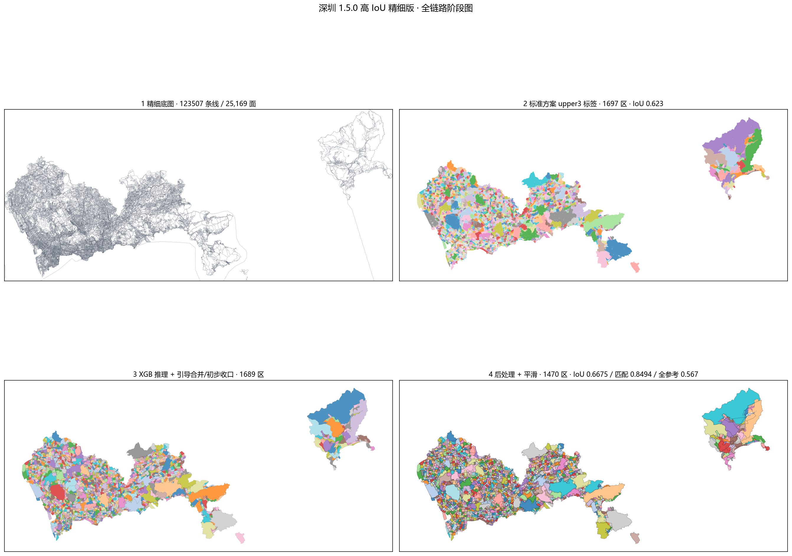
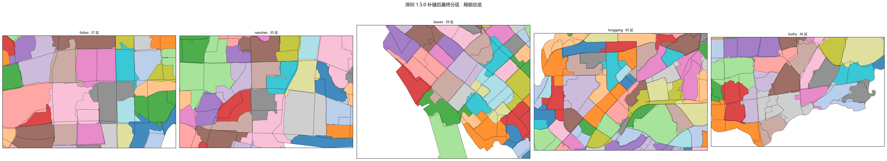
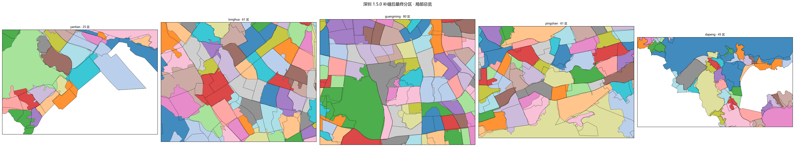
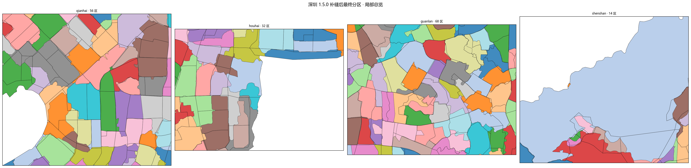
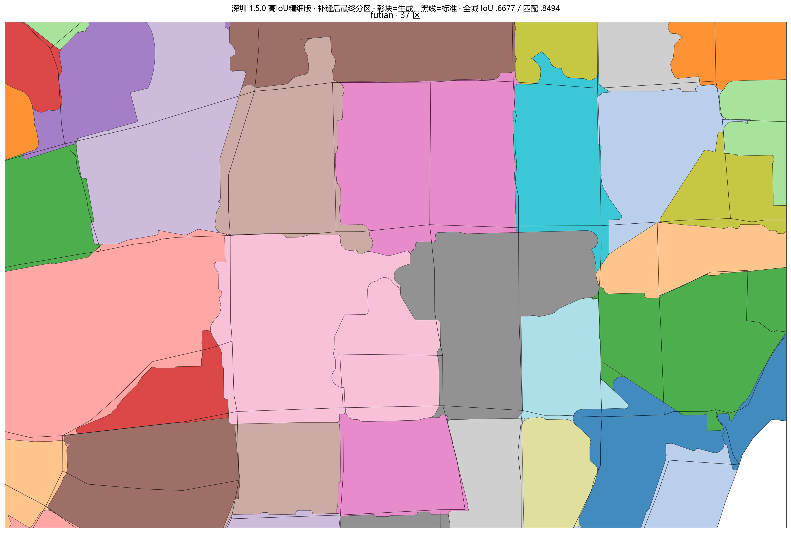

# FineGrid-XGB 1.5.0 方法说明

## 1. 输入与输出

**输入**

- 本地省份 OSM PBF；
- 行政区（省/市/县）或自定义 bbox；广东 21 市使用内置陆地边界，其余按行政 bbox；
- 省级：省域面积 ≤25,000 km² 一次推理；更大省份按市/州逐个推理再聚合，
  广东使用内置 21 市边界，其他省份从 PBF 的行政面提取市/州边界；
- 运行时参数：面块对合并阈值（默认 0.8）、引导合并目标（0.6 km²）、碎块吸收（0.3 km²）。

**输出**

- 分区 GeoJSON（WGS84），每个要素含 `zone`、`name`、`name_src`、`area_km2`；
- 运行统计：原始面块对数、原始连通分区、吸收/包络合并数、洞、多部件、耗时等。

## 2. 在线推理流程

1. **OSM 预处理**：从 PBF 提取道路、铁路、水系和边界特征线；道路单线化、
   近重复合并、断点修复、道路走廊清理；投影到 Albers。
2. **面网**：线网与区域边界一起节点化、多边形化，保留 ≥10,000 m² 的原子面。
3. **特征**：面块对 58 个几何/边界/邻接特征 + 32 个 OSM 用地/自然/POI
   上下文特征，共 90 列。
4. **XGB 推理**：部署模型 `province_1_5_0_pbf_hc2` 输出每对相邻面块“应合并”
   概率；阈值 0.8 做并查集得到原始分区。
5. **XGB 引导小区块合并**：面积小于 0.6 km² 的分区，沿相邻面块对概率最高、
   边界加权最强的邻居合并，要求最大概率 ≥0.5，合并后面积 ≤40 km²；最多 30 轮。
6. **后处理**：吸收 0.3 km² 以下碎块、补缝、消重叠、包络合并、清洞、2 m
   简化、1 cm 精度修复。
7. **形态平滑**：全部区域做 20 m 开闭运算；对面积 <10 km² 且紧致度 <0.35 的
   城市区再做 60 m 定向平滑，清理多部件。
8. **最终补缝**：在区域边界内找出未覆盖碎片，并入共享边界最长的相邻分区；
   复杂缝隙按相邻区 Voronoi 拆分；清理残余洞与多部件。
9. **分区命名**：从 PBF 读取带 `name` 的点/线/面；按“分区内地名点 → 分区内
   道路 → 用地/水系/自然面 → 800 m 内地名点 → 兜底”取名，同名加（序号）；
   省级聚合时同名分区再追加所在城市名。
10. **省级聚合**：各市结果裁剪到省域边界，过滤 <1,000 m² 碎片，统一重编
    `zone` 并重算 `area_km2`；市级结果缓存在 `cache/province_agg/`，可断点续跑。
11. **深圳验收 profile**：`pipeline/runner.py` 的 `CITY_PROFILES["深圳"]` 固化
    深圳验收方法：详细线网 + 启用 `cls2` 语义边界特征 + 阈值 0.8、引导目标
    0.6 km²、最小合并概率 0.5、上限 40 km²、碎块吸收 0.3 km²、全域 20 m +
    低紧致度 60 m 平滑。缓存 meta 记录 profile 名，profile 变更会触发重建。
    发布模型训练时只有深圳的 `cls2` 特征非零，因此这是显式的深圳验收配置；
    其他城市保持训练一致的 `cls2=0` 路径。统一公平口径需用全省统一特征重训。

## 3. 训练与标签（离线完成，不在前端）

- 训练标签来自标准方案微网格：原子面按参考格最大重叠赋 `ref_id`，再做
  **连续化 upper3** 标签，消除标签孤岛；参考方案只用于离线训练/评估。
- 训练数据：广东 21 市 568,257 个面块对，90 特征，CPU `hist`。
- 部署模型 `province_1_5_0_pbf_hc2`：全量训练 AUC 0.9843；城市整组留出
  AUC 约 0.812，2 km 瓦片 CV AUC 约 0.819。
- 面积校准 `area_calibration.pkl`：随机森林由 OSM-only 特征预测目标面积 p50，
  用于离线分析；在线 FineGrid 流程使用固定 0.3 km² 吸收阈值。
- 训练/数据构建/评估代码与逐市指标脚本见 `training/README.md`；PBF 和标准
  方案 CSV 由使用者放入 `training/` 对应目录。

## 4. 深圳参考结果

| 指标 | 数值 |
|---|---|
| 分区数 | 1,470 |
| 贪心 1-1 IoU | 0.6677 |
| 匹配率 | 0.8494 |
| 全参考 IoU | 0.5671 |
| 边界 F1@25 m | 0.506 |
| 洞 / 多部件 | 0 / 0 |
| 分区面积 p50 | 0.814 km² |

该结果来自部署模型在深圳的离线评估；其他城市/省份受 OSM 覆盖、标准方案差异
和底图细节影响，指标会变化。

## 5. 结果图

全链路阶段图：

最终分区局部总览：

## 6. 已知限制

- 大省省级生成需要逐市推理，首次耗时较长；市/州结果有落盘缓存，可续跑；
- 非广东城市按 bbox 或 PBF 行政面裁剪，沿海区域可能包含少量海域；
- 跨省使用属于零样本，建议在目标省份 OSM 上重新校准或训练；
- 首次生成某地区需要构建底图和特征，耗时数分钟；缓存命中后明显加快；
- 推理不读取标准方案 CSV。
