# FineGrid-XGB 1.5.0 算法详解（新人版）

> 这份文档面向**第一次接触本项目的人**：不需要 GIS、机器学习背景，也能从
> “OSM 数据长什么样”一路读到“前端为什么会出现这些分区”。
>
> 阅读顺序建议：先看第 0 节流程图和第 1 节术语表，再看第 2 节工程结构，
> 然后按第 3～13 节顺序阅读。第 14、15 节是深圳坪山、广州海珠的逐阶段图，
> 第 16 节是历史 1.3.0 深圳验收图（档案对照），可以对照着看。
>
> **文档分工**：本文讲流程、动作含义、图和示例；开发过程证据（清洗前后、
> 候选线评测、标准方案未覆盖边界、upper3、后处理消融、XGB/SHAP、省外示例）
> 在 `DEVELOPMENT_EVIDENCE.md`；90 个特征的公式/逐特征解释、所有阈值和
> 代码位置在 `FEATURES_AND_THRESHOLDS.md`；交付包清单在 `../DELIVERY.md`。

---

## 0. 一页看懂

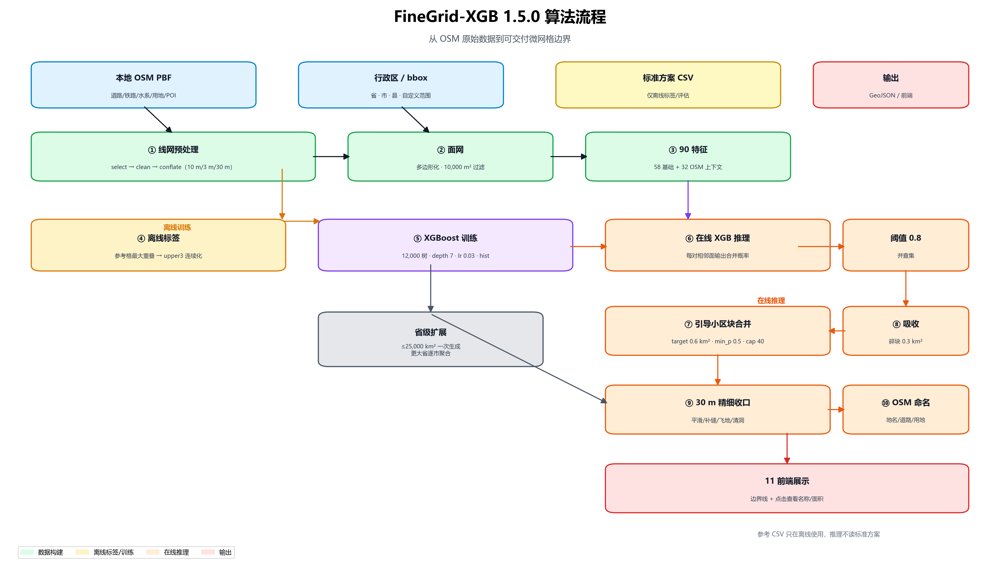

用一句大白话说：

> **OSM 是地图原材料；线网是切蛋糕的刀；原子面是切出来的小蛋糕块；
> XGBoost 是裁判，判断相邻两块该不该拼成同一块；收口算法把碎边修平；
> 最后用 OSM 里的地名给每块蛋糕起名字。**

流程拆成 10 步：

1. 从本地 PBF 读取道路、铁路、水系、用地、行政边界、POI；
2. 清洗线网：去重、接断头、语义合并，得到“一条边只留一条”的干净底图；
3. 用线网把城市切成原子面（最小的街区/地块）；
4. 离线用标准方案给原子面打训练标签（推理时不使用）；
5. 对每对相邻原子面提取 90 个特征；
6. 训练 XGBoost 模型，学习“哪些相邻面应该合并”；
7. 在线推理：模型给每对相邻面一个合并概率；
8. 先按阈值合并，再把过小的碎区沿最强边界合并；
9. 吸收碎块、消重叠、补缝、30 m 精细平滑，保证 0 洞/0 多部件；
10. 用 OSM 的 `name` 字段给分区命名，输出 GeoJSON 给前端。

当前交付（hc4 统一模型 + 30 m 收口）的深圳数字：

```text
参考方案：1,707 个微网格
最终结果：1,271 个分区
贪心 1-1 IoU：0.6057
匹配率：0.7147
全参考 IoU：0.4329
边界 F1@25 m：0.4742
洞 / 多部件：0 / 0
```

历史 1.3.0 单市验收版（60 m，档案对照）：

```text
最终结果：1,470 个分区
贪心 1-1 IoU：0.6677
匹配率：0.8494
全参考 IoU：0.5671
边界 F1@25 m：0.5065
洞 / 多部件：0 / 0
```

---

## 1. 先认识名词（术语表）

| 名词 | 大白话解释 | 在本项目里做什么 |
|---|---|---|
| OSM | OpenStreetMap，开放地图数据，类似“地图版维基百科” | 唯一的在线推理数据来源 |
| PBF | OSM 数据的一种压缩文件格式 | 放在 `data/china/`，例如 `guangdong-260918.osm.pbf` |
| 节点 / 线 / 关系 | OSM 的基本元素：点、线、多边形关系 | 道路是线、水面是面、行政边界是关系 |
| tag（标签） | OSM 给要素打的属性，例如 `highway=primary` | 决定这条线是主干道还是步道 |
| highway | 道路等级标签 | major/secondary/tertiary/local/weak 五档 |
| landuse | 用地标签，例如住宅、商业、工业 | 提供面积边和上下文特征 |
| natural | 自然标签，例如林地、草地、水面 | 提供自然边界 |
| POI | Point of Interest，兴趣点，例如学校、商场 | 提供密度上下文特征 |
| 行政边界 | 省/市/县/镇的边界 | 裁剪城市范围、辅助命名 |
| WGS84 | 经纬度坐标系（EPSG:4326） | 输入输出 GeoJSON 使用 |
| Albers | 等面积投影，单位是米 | 计算面积、缓冲区、合并时使用 |
| GeoJSON | 用 JSON 表示点线面的格式 | 前端最终读取的分区文件 |
| `make_valid` | 修复自相交、空洞等非法几何 | 所有几何处理前的保险 |
| explode | 把 MultiLineString/MultiPolygon 拆成单条/单块 | 便于逐条去重和绘图 |
| simplify | 简化折线，减少顶点 | 3 m 简化，降低后续计算量 |
| 多边形化 | 用线网把平面切成封闭小面 | 得到“原子面” |
| 原子面 | 线网切出来的最小面，不能再被内部线切开 | 后续合并的基本单位 |
| 去重 / dedupe | 把重复画的两条线去掉一条 | 避免产生大量 5–10 m 的假窄面 |
| 断点修复 / heal | 把悬空的线头接到最近的线 | 让线网闭合，能切出完整面 |
| 语义合并 / conflation | 不同类别但表达同一条边界的线合并 | 例如 landuse 边和道路边只留一条 |
| `cls2` | 每条线的语义类别（13 类） | 生成 38 个边界类别特征 |
| 参考方案 | 标准微网格 CSV，第三方数据 | 只用于离线标签/评估，推理不读 |
| ref_id | 每个原子面按最大重叠分到的参考格编号 | 构造训练标签 |
| upper3 | 把最大重叠标签连续化的算法 | 消除“标签孤岛”，让训练目标更合理 |
| 面块对 | 两个相邻且有共享边的原子面 | XGBoost 的一条训练/推理样本 |
| 特征 | 描述面块对的数字，例如面积、边界长度、POI 密度 | 模型判断的依据 |
| XGBoost | 一种梯度提升决策树集成模型 | 输出“合并概率” |
| `hist` | XGBoost 的直方图算法，适合 CPU | 本项目只用 CPU |
| AUC | 模型排序能力指标，0.5=随机，1=完美 | 训练/验证指标，不是最终 IoU |
| 阈值 | 概率超过多少才合并 | 当前 0.8 |
| 并查集 | 管理“谁和谁已经连成一伙”的数据结构 | 按概率阈值合并面块 |
| 引导合并 | 把太小的分区沿最强 XGB 边并给邻居 | 目标 0.6 km²，避免碎区 |
| 吸收 | 把小碎块并到相邻大区 | 当前 0.3 km² |
| 缓冲 / buffer | 把多边形向外或向内扩/缩一定距离 | 30 m 平滑的基础操作 |
| 开闭运算 | 先缩再扩 / 先扩再缩 | 去掉毛刺、填小凹口 |
| 重叠 | 两个分区盖住了同一块地 | 收口必须消除 |
| 缝隙 | 城市范围内没有被任何分区覆盖的地方 | 收口必须补齐 |
| 洞 | 一个分区内部有空洞 | 交付要求 0 |
| 多部件 | 一个分区由几块不相连的多边形组成 | 交付要求 0 |
| 飞地 / enclave | 被另一个分区完整包围的小分区 | 收口时并入宿主 |
| Voronoi | 按最近种子点切分空间 | 复杂缝隙按最近邻分区拆分 |
| IoU | 交并比：重叠面积 / 并集面积 | 评估分区与参考的重合度 |
| 贪心 1-1 IoU | 按 IoU 从高到低一对一配对后的平均 IoU | 深圳验收主指标 |
| 匹配率 | 参考格中成功一对一匹配的比例 | 衡量“覆盖了多少参考格” |
| 全参考 IoU | 所有参考格上的匹配 IoU 总和 / 参考格数 | 惩罚漏匹配 |
| 边界 F1@25 m | 生成边界与参考边界在 25 m 内的 F1 | 衡量边界贴合 |
| 省级一次性 | 小省面积 ≤25,000 km²，直接整省跑 | 减少聚合开销 |
| 省级聚合 | 大省按市跑，再裁到省界拼起来 | 广东 21 市模式 |
| 零样本 | 模型没在目标省份训练过，直接套用 | 跨省使用要谨慎 |

---

## 2. 工程目录与文件作用

### 2.1 顶层结构

```text
FineGrid-XGB-1.5.0/
├─ run.py                     启动 FastAPI（前端 + 后端同一个进程）
├─ requirements.txt           推理依赖
├─ README.md                  快速启动、数据放置、结果说明
├─ LICENSE.md                 许可
├─ app/                       FastAPI 路由与服务
├─ pipeline/                  算法核心（预处理/推理/收口/命名）
├─ web/                       单页前端（MapLibre）
├─ models/                    发布模型与面积校准
├─ data/                      PBF / 参考 CSV / 城市陆域边界
├─ cache/                     运行时缓存（可删除重建，不入 Git）
├─ training/                  离线训练、数据构建、评估代码
└─ docs/                      方法说明、算法详解、图片
```

### 2.2 `app/`：Web 服务

| 文件 | 作用 |
|---|---|
| `main.py` | FastAPI 入口，挂载 `web/`，提供 `/health`、`/api/*` |
| `finegrid_api.py` | `/zoning/*` 接口：省目录、任务、结果、图层、缓存清理 |
| `province_service.py` | 省级生成：小省一次性/大省逐市聚合 |
| `providers.py` | 扫描 `data/china` PBF，提供省/市/县目录 |
| `jobs.py` | 单工作线程任务队列，前端轮询进度 |
| `china_provinces.json` | 中国省级目录：ID、名称、bbox、demo 范围 |
| `__init__.py` | 包标记 |

### 2.3 `pipeline/`：算法核心

| 文件 | 作用 |
|---|---|
| `runner.py` | 全流程编排：校验区域 → 缓存 → 预处理 → 推理 → 收口 → 命名 |
| `legacy_online.py` | 无预生成底图时，按训练同一条 1.3.0 链在线构建底图 |
| `geo.py` | Albers 投影、ROOT、城市边界读取等公共函数 |
| `lines.py` | 在线线网提取/清理（当前推理路径） |
| `road_dedupe.py` | 道路平行去重、走廊清理 |
| `conflate.py` | 语义合并 `conflate`、`classify_cls2` |
| `faces.py` | 线网多边形化，生成原子面 |
| `pairs.py` | 面块对基础特征（58 个） |
| `pbf_features.py` | OSM 上下文特征（32 个：建筑/用地/POI） |
| `finalize.py` | 引导合并、后处理、`refine_best` 30 m 收口、平滑 |
| `seal_ops.py` | 拓扑工具：消重叠、补缝、清洞、Voronoi、多部件拆分 |
| `calibration.py` | 面积校准模型加载/预测 p50 |
| `reference.py` | 参考 CSV 读取与 IoU/边界指标 |
| `naming.py` | 用 OSM 名称给分区命名 |
| `osmconf.ini` | GDAL OSM 读取配置 |
| `__init__.py` | 包标记 |

### 2.4 `training/`：离线训练与评估

| 目录/文件 | 作用 |
|---|---|
| `tools/osm_base_select.py` | 选择候选线网（13 类全保留） |
| `tools/osm_base_clean.py` | 线段级去重与断点修复 |
| `tools/base_conflate.py` | 语义合并（10 m 规则） |
| `tools/build_legacy_substrate.py` | 按 1.3.0 深圳范式重建全部城市底图 |
| `tools/build_province_lines.py` | 从 PBF 构建各市清理线缓存 |
| `tools/build_province_frames.py` | 构建 21 市陆域边界 |
| `tools/build_province_1_5_0.py` | 线网 → oracle/upper3 → pairs |
| `tools/build_province_face_pairs.py` | 面块对 58 基础特征 |
| `tools/build_faces_from_lines.py` | 从线网构建原子面（在线链，与 oracle 同一多边形化） |
| `tools/augment_pairs_pbf.py` | 追加 32 个 OSM 上下文特征 |
| `tools/rebuild_cls2_pairs.py` | 统一重算 21 市 cls2 pairs |
| `tools/oracle_osm_upper_bound.py` | 参考格最大重叠上限面/标签 |
| `tools/build_contiguous_upper3.py` | upper3 连续化标签 |
| `tools/train_province_deep.py` | 训练部署模型（12,000 树） |
| `tools/train_province_1_5_0.py` | 城市整组留出验证模型 |
| `tools/eval_uniform_city.py` | 用最新 `refine_best` 评估单市 |
| `tools/province_partition.py` | 逐市分区与收口 |
| `tools/city_metrics.py` | 逐市指标 CSV |
| `tools/aggregate_province.py` | 全省聚合图/摘要 |
| `tools/compare_iou.py` | 单市 IoU/边界指标 |
| `tools/eval_province_thresholds.py` | 阈值扫描 |
| `tools/absorb_small_zones.py` | 碎块吸收工具 |
| `tools/raster_gap_fill.py` | 栅格补缝工具 |
| `tools/finalize_sz_clean.py` | 深圳收口实验工具 |
| `tools/external_region_1_5_0.py` | 省外区域示例流程 |
| `tools/area_calibration.py` | 面积校准训练 |
| `tools/augment_province_aux.py` | 追加行政/用地/POI 辅助边 |
| `commercial_zoning/` | 线网构建、道路去重、陆地掩膜、收口代码 |
| `pipeline/` | 训练/评估用算法副本（`finalize.py` 与根目录同步） |
| `scripts/run_legacy_reproduction.sh` | 旧范式 21 市重建 + hc4 + 深圳评估 |
| `scripts/run_province_1_5_0.sh` | 历史统一 cls2 实验链（hc3，不发布） |
| `assets/legacy_shenzhen_1_3_0/` | 精确深圳 1.3.0 旧底图/标签/pairs |
| `commercial_zoning/cache/clean_lines_aux/` | 21 市清理线数据资产 |
| `accepted/` | 验收结果 GeoJSON 与精简指标 |
| `models/` | 验证模型、OOF 概率、面积校准（hc4 在 `commercial_zoning/models/`） |
| `results/` | 基线指标、统一模型评估结果 |
| `README.md` | 训练、评估、内存与全国扩展说明 |

### 2.5 `web/`、`models/`、`data/`、`docs/`、`cache/`

| 路径 | 作用 |
|---|---|
| `web/index.html` | 单页前端：省/市/县选择、地图、进度条、弹窗 |
| `web/vendor/` | 本地 MapLibre JS/CSS（离线可用） |
| `models/province_1_5_0_pbf_hc4/` | 当前发布模型 `merge_model.ubj` + 90 特征表 + 元数据（hc2 为历史版本，不加载） |
| `models/area_calibration.pkl` | OSM-only 面积校准模型 |
| `data/china/` | 省份 PBF（本交付文件夹已放入；Git 不跟踪） |
| `data/reference/` | 标准方案 CSV（本交付文件夹已放入；Git 不跟踪） |
| `data/frames/` | 广东 21 市陆域边界 |
| `docs/DELIVERY.md` | 完整交付包清单与各目录大小 |
| `docs/algorithm_guide/FEATURES_AND_THRESHOLDS.md` | 90 特征公式/逐特征解释、全部阈值、代码位置 |
| `docs/algorithm_guide/` | 新人流程指南、特征/阈值参考、流程图、逐阶段图、验收图 |
| `cache/` | 底图缓存、前端生成结果、省级聚合缓存；可删除重建 |

---

## 3. 阶段 0：输入与范围

**这一阶段在做什么？**

系统先确定“你要算哪一块地方”，然后只读这一块对应的本地 PBF。

输入有三种：

1. 选省 → 市 → 县/区；
2. 直接选市；
3. 自定义 bbox（经纬度矩形）。

约束：

- 没有本地 PBF 的省份/地区直接提示“无本地 OSM 数据”，不联网下载；
- 自定义 bbox 上限 25,000 km²；
- 广东 21 市用内置陆域边界，避免把海面算进去；
- 其他省份从 PBF 行政面提取边界，或者按行政 bbox 裁剪。

**具体例子**：在页面上选择“广东 → 深圳 → 福田区”，前端会把福田的 bbox
传给后端，后端扫描 `data/china/`，找到 `guangdong-260918.osm.pbf`，后续只
读取这个文件里福田范围内的要素。若改选一个没有本地 PBF 的省份，页面会提示
“目前无本地 OSM 数据”，而不是偷偷联网下载；若拖一个很大的自定义框，系统会
按 25,000 km² 上限拒绝，避免一次性把过大的几何读进内存。

对应代码：`app/finegrid_api.py`、`app/providers.py`、`pipeline/runner.py`。

---

## 4. 阶段 1：OSM 线网提取

### 4.1 这一阶段在做什么？

把 PBF 里的道路、铁路、水系、水面、用地、自然、行政边、POI 取出来，变成
可以计算的多段线。

**PBF 就像一个大压缩包**，里面有节点、线、关系；我们只关心能当地图边界的
要素。

**具体例子**：在深圳 PBF 里，深南大道通常带 `highway=primary`，会被归到
major；华强北附近的小路可能是 `highway=residential`，归到 local；小区内部
的步行道可能是 `highway=footway`，归到 weak；深圳河带 `waterway=river`；
莲花山公园可能带 `landuse=park` 或 `leisure=park`。它们在同一张地图上，
但语义完全不同，必须分别保留并打上类别。

### 4.2 道路五档

| 档位 | 包含的 `highway` | 直觉 |
|---|---|---|
| major | motorway、trunk、primary（含 link） | 高速/快速路/主干道 |
| secondary | secondary | 次干道 |
| tertiary | tertiary | 支路 |
| local | residential、unclassified、living_street、road | 小区路、一般街道 |
| weak | service、footway、path、track、cycleway、steps、pedestrian | 服务路、步道、小路 |

**为什么 weak 也要保留？**

因为标准方案在城区大量使用小区内部路、步道、宗地边作为微网格边界。
实验数据：深圳只保留强道路时，上限只有 1,336 区（参考 1,707），IoU 0.388；
保留 weak 后上限 1,703 区、IoU 0.6744。删 weak 会直接把很多真实边界删没。

### 4.3 几何清理

1. `make_valid`：修复自相交、空洞；
2. explode：把 MultiLineString 拆成单条；
3. 投影到 Albers（米制）：面积、缓冲、长度计算都在这里做；
4. simplify(3 m)：顶点太密会让后续多边形化变慢；
5. 丢掉 <15 m 的短线。

深圳候选线数量（13 类）：

```text
weak 113,851 / local 31,154 / landuse 20,831 / tertiary 8,583 /
major 7,484 / stream 6,952 / rail 5,583 / secondary 5,545 /
water 3,890 / poi 3,801 / natural 3,526 / river 1,011 / admin 928
```

---

## 5. 阶段 2：线网清洗（1.3.0 深圳范式）

这是整个算法最关键的阶段。可以把它想成“把一张毛糙的草稿图描成干净的
线稿”。

### 5.1 候选选择

不按类别硬删，13 类全部保留；只做统一几何清理和类别标注。原因：
不同区域依靠不同类别：

- 城建区：landuse ≈58.6%、weak ≈12.0%、local ≈9.7%；
- 乡镇区：major ≈22.1%、tertiary ≈13.2%、secondary ≈10.2%；
- 自然区：natural ≈30.7%、weak ≈16.8%、admin ≈16.2%。

### 5.2 线段级去重

问题：OSM 里同一条路可能画了两三遍，或者主干道旁边 5–10 m 有一条同名辅路；
如果直接切面，会得到大量 5–10 m 的假窄面。

做法：

1. 把线按 **20 m** 段化（旧版 QA 统计用 40 m 段）；
2. 比较平行段：角度 ≤25°，并且两个端点都在带内；
3. 同 `name`/`ref`：10 m 带内认为是同一特征；
4. 不同名/无名：只有 **≤2 m 近重合**才算重复（5–10 m 往往是真实的两条街）；
5. 低优先级线只删“重合段”，不整条删除；
6. 断点修复：先 80 m、再 300 m，把断头接到最近线；
7. 丢掉 <5 m 的微短段。

深圳这一步：

```text
候选 213,139 条
段化后约 267 万段
扣除约 86.7 万段
断点修复新增约 8.6 万条连接
输出约 155,629 条 / 33,414 km
```

### 5.3 语义合并 `base_conflate`

问题：道路和 landuse 边可能只隔 5–8 m，画的是同一条边界；行政界可能重复；
铁路场有多股道。

规则：

1. 同 `osm_id`/`name`/`ref` → 保留高优先级；
2. 面积边与道路/铁路/水系/行政界在 **10 m** 内平行 → 保留基础设施线；
3. 相邻面积面的共享边在 **3 m** 内 → 只留一条；
4. 重复行政界 **3 m** 内 → 保留较低级别；
5. 多股铁路 **10 m** 内 → 留一条；
6. degree-2 同特征线合并；
7. 断点再修 **30 m**；
8. 重复跑 2 轮。

参数：

```text
--tol 10 --rail-tol 10 --weak-tol 3 --admin-tol 3 --area-tol 3
--heal 30 --passes 2
```

深圳结果：

```text
输入 155,629 条 / 33,414 km
去掉约 15.8 万段
输出 136,738 条 / 30,609 km
```

旧 1.3.0 验收底图：123,507 条 / 29,715 km；当前旧范式链已经非常接近。

### 5.4 直观例子

想象福田某处：

- 一条主干道旁 6 m 有一条同名辅路；
- 一条 landuse 边沿着主干道 8 m 外画；
- 它们各自有断头。

清洗后：

1. 辅路重合段被去掉；
2. landuse 面积边重合段被去掉；
3. 断头接到主干道；
4. 最后只剩一条线作为面边界。

如果不做，后面会多出很多细长面，XGB 会被迫学习“假碎面要不要合并”。

**再具体一点**：假设某条主干道和一条 6 m 外的同名辅路都保留下来，切面后
它们之间会形成宽约 6 m、长几百米的细长面；再叠加一条 8 m 外的 landuse 边，
又会多出一条细长面。真实街区只有一块，但底图会多出几十个假面块对。
模型在训练时看到大量这种“假碎面”，会学成“见小面就合并”，反而破坏真实
边界。清洗阶段省掉的是后面的麻烦，不是单纯为了图好看。

---

## 6. 阶段 3：面网

### 6.1 这一阶段在做什么？

把线网当成“刀”，把城市切成一块块封闭的小面。

1. 线网 + 城市陆域边界一起节点化（所有交点打断）；
2. 多边形化；
3. 过滤 <10,000 m² 的碎面；
4. 裁剪到陆地边界。

**具体例子**：一条主干道、一条支路、一条小区边界围成一个三角形街区；
三条线在三个路口相交，多边形化后得到一个约 0.05 km² 的原子面。如果中间
还有一条内部小路，它会把街区再切成两个原子面；如果内部小路和外部道路
没接上，断点修复会先把小路口接上，否则切出来的面不闭合。原子面不是
“最终分区”，只是后面 XGB 的最小拼图块。

### 6.2 深圳数字

| 版本 | 原子面 | 面块对 |
|---|---:|---:|
| 旧 1.3.0 | 25,169 | 48,456 |
| 旧范式链 | 24,819 | 45,555 |
| fresh 直连（失败对照） | 24,745 | 37,870 |

面数差不多，但邻接关系差很多：fresh 直连产生大量孤立面/悬空线，
很多面之间没有 ≥10 m 的稳定共享边。

对应代码：`pipeline/faces.py`、`training/tools/oracle_osm_upper_bound.py`。

---

## 7. 阶段 4：离线标签

### 7.1 参考格最大重叠

把标准方案 CSV 的每个格子与原子面求交，原子面归到重叠面积最大的参考格，
得到 `ref_id`。

这只是一个**上限标签**：告诉模型“如果完全按标准方案，这块面属于哪个区”。

### 7.2 upper3 连续化

问题：最大重叠会产生“标签孤岛”：一个小区被周围另一个区包围，训练目标
不连续，模型很难学。

upper3：

1. 找最大连通块作为种子；
2. 按重叠/邻接关系生长；
3. 多次迭代；
4. 得到连续、连通的训练区。

**具体例子**：一个只有 0.03 km² 的小区，按最大重叠可能被单独分到参考格 A，
但它四周几乎都是参考格 B。直接训练会让模型看到“周围都该合并、它自己却
不同”的矛盾样本；upper3 会把这个小区并进 B，或者按重叠面积重新生长，
让训练标签在空间上连续。注意这只改变“训练目标”，不改变推理时看到的 OSM
数据；推理时没有参考格。

深圳：

| 版本 | upper3 区数 | IoU | 匹配率 | 全参考 IoU | 边界 F1 |
|---|---:|---:|---:|---:|---:|
| 旧 1.3.0 | 1,697 | 0.623 | 0.9936 | 0.619 | 0.475 |
| 旧范式链 | 1,696 | 0.5985 | 0.9936 | 0.5947 | 0.4586 |
| fresh 直连 | 1,685 | 0.536 | 0.9848 | 0.5278 | 0.4295 |
| 参考方案 | 1,707 | — | — | — | — |

**注意：参考 CSV 只在离线训练/评估使用；在线推理完全不读它。**

---

## 8. 阶段 5：面块对与 90 个特征

每对相邻原子面（共享边 ≥10 m）形成一条样本。90 个特征分两大部分：

- **58 个基础特征**：面积/形状/边界/边界类别/面内类别密度/邻接图/邻居统计；
- **32 个上下文特征**：建筑（当前关闭）、用地、POI。

直觉：模型不是孤立看一块面，而是看两块面的关系——中间隔什么路、共享边多长、
面积是否悬殊、两侧用地和 POI 是否相似。

一个示意样本：

```text
a_area=0.052 km², b_area=0.038 km², area_ratio=0.73, border_m=86
bf_secondary=0.61, bf_local=0.22, bf_landuse=0.17
a_lu_built=0.84, b_lu_built=0.91
a_poi_density=12.4, b_poi_density=18.7
centroid_m=210, a_deg=5, b_deg=6, common_nbr=3
```

完整公式见 `FEATURES_AND_THRESHOLDS.md` 附录 A；逐特征解释见 `FEATURES_AND_THRESHOLDS.md` 附录 D；
阈值和判定规则见附录 B。

**再看两个对比例子**：

- 两块面边界 80 m，`bf_major=0.8`，`a_poi_density`/`b_poi_density` 都很低：
  更像被主干道分开的两片区域，模型倾向不合并；
- 两块面边界 200 m，`bf_local=0.7`，`a_lu_built`/`b_lu_built` 都接近 1，
  `common_nbr` 高：更像同一个小区被内部道路切开的两块，模型倾向合并。

同样 90 个数字，不同的组合会让 XGB 走到不同的树分支；这就是为什么
不能只靠“边界长度”或“面积”单指标做规则。

## 9. 阶段 6：XGBoost 训练

### 9.1 这个模型到底在回答什么问题？

训练和推理的输入都不是“一块面”，而是一对相邻面 A、B 的 90 个数字。
模型输出一个 0–1 的概率：

```text
p = P(A 和 B 应该属于同一个微网格)
```

它不是在预测“面积”，也不是在预测 IoU，而是在判断一对面的“合并倾向”。
最终是否合并由外部阈值和后处理决定。

### 9.2 一棵决策树长什么样

一棵树就是一连串 if/else。例如（只是示意，不是真实模型）：

```text
if border_m < 40:
    leaf = -0.8      # 只挨着一点，倾向不合并
elif bf_major > 0.5:
    leaf = -0.4      # 边界是主干道，倾向不合并
elif bf_local > 0.2 and centroid_m < 120:
    leaf = +0.6      # 边界是小区路、两face很近，倾向合并
else:
    leaf = +0.1
```

- `border_m` 是共享边长度；
- `bf_major` 是边界靠近主干道的比例；
- `bf_local` 是边界靠近小区路的比例；
- `centroid_m` 是两块面质心距离。

叶子里的数是一个“分数”（log-odds 的一部分），不是最终概率。
`max_depth=7` 表示每棵树最多 7 层，最多约 2^7=128 个叶子；
12,000 棵树意味着模型可以表达很多细粒度的特征组合。

### 9.3 12,000 棵树如何组成一个模型

XGBoost 是**加法模型**：

```text
第 0 步：初始分数 F0 = 0
第 1 棵树：F1 = F0 + learning_rate × tree1(x)
第 2 棵树：F2 = F1 + learning_rate × tree2(x)
...
第 12000 棵树：F = F0 + 0.03 × Σ tree_k(x)
p = sigmoid(F) = 1 / (1 + e^(-F))
```

- 每棵新树不是独立投票，而是去拟合前面模型的残差/梯度；
- `learning_rate=0.03` 让每棵树只贡献一小步，12,000 棵树累积起来；
- 把所有树的分数相加，再 sigmoid，得到 0–1 概率。

**示意**：假设 3 棵树的叶分数分别为 +0.6、+0.5、+0.4，学习率 0.03：

```text
F = 0.03 × (0.6 + 0.5 + 0.4) = 0.045
p = sigmoid(0.045) ≈ 0.511
```

如果树分数更大，例如累计 F=1.5，则 `p≈0.818`；如果累计 F=-1.0，
则 `p≈0.269`。真实模型有 12,000 棵树，分数会精细得多。

整张架构可以画成这样：

```text
            90 维面块对特征 x
                    │
      ┌─────────────┼─────────────┐
      ▼             ▼             ▼
   tree_1        tree_2   ...  tree_12000
   (depth≤7)     (depth≤7)      (depth≤7)
      │             │             │
   leaf=+0.4     leaf=-0.2     leaf=+0.7
      └─────────────┼─────────────┘
                    ▼
       F = 0.03 × (leaf_1 + leaf_2 + ... + leaf_12000)
                    ▼
             p = sigmoid(F) ∈ [0,1]
                    ▼
        阈值 0.8：p≥0.8 才倾向合并
```

注意：上图的叶分数只是示意；真实模型每棵树的叶分数由训练数据决定。
模型内部没有“如果面积>0.6 就合并”这样的手写规则，所有分裂点都是训练学出来的。

### 9.4 部署模型参数逐个解释

| 参数 | 值 | 它在控制什么 |
|---|---:|---|
| `n_estimators` | 12,000 | 树的数量；越多表达力越强，也越慢 |
| `max_depth` | 7 | 每棵树的深度；越深能学越复杂的交互，也越容易过拟合 |
| `learning_rate` | 0.03 | 每棵树的步长；小步长需要更多树，但更稳 |
| `subsample` | 0.9 | 每棵树随机用 90% 样本，降低过拟合 |
| `colsample_bytree` | 0.9 | 每棵树随机用 90% 特征，降低特征相关性 |
| `min_child_weight` | 2 | 叶子最小样本权重；太小会记住噪声 |
| `reg_lambda` | 1.0 | L2 正则，惩罚过大的叶子分数 |
| `tree_method` | `hist` | CPU 直方图算法，内存友好 |
| `max_bin` | 64 | 连续特征分成 64 个桶；桶越多越精细，越耗内存 |
| `n_jobs` | 4 | 4 线程 CPU 训练 |
| `random_state` | 0 | 固定随机种子，保证可复现 |

**为什么用 `hist` 而不是 GPU？** 本项目要求 CPU 运行；`hist` 先把特征分桶，
在直方图上找分裂点，内存和速度都适合 73 万级样本。`max_bin=64` 是精度和
内存的折中。

### 9.5 模型真正依赖哪些信号

树不会只看一个特征。举例：

- 两块面 `border_m=86`，但一边是 `bf_secondary=0.6`、另一边是
  `bf_local=0.6`；前者是次干道，后者是小区路，模型会给出不同判断；
- 两块面 `area_ratio=0.9` 但 `centroid_m=600`，可能是细长条；
- `a_lu_built=0.9, b_lu_built=0.1`，一边城市一边空地，模型会更谨慎；
- `common_nbr` 很高，说明它们在同一个街区图里，可能倾向合并。

模型没有城市 ID、没有坐标绝对位置、没有参考格标签；它只看到 OSM 特征。
这也是它能跨城市使用的原因（跨省仍是零样本）。

### 9.6 部署模型 vs 公平验证模型

| 模型 | 用途 | 架构 |
|---|---|---|
| 深层部署模型 | 实际出图 | 12,000 树、depth 7、lr 0.03、全 21 市训练 |
| 正则化验证模型 | 公平评估 | 4,000 树 + early stopping 100 轮，depth 4–7 网格搜索 |

部署模型（hc4）train AUC 约 **0.9866**，但这是 in-sample 指标；hc2 时期
正则化验证模型给出的公平口径为：

```text
城市整组留出 AUC 约 0.812
2 km 瓦片 CV AUC 约 0.819
城市 OOF AUC 约 0.810
```

城市留出意味着“测试城市完全没进训练”，所以更能代表跨城泛化能力。
hc4 已用统一 `cls2` 数据和旧范式底图重训并部署；由于训练集扩大到
733,311 对、模型要在 21 市间做统一取舍，深圳指标低于历史单市验收版，
逐市结果见 `training/MODEL_CARD.md`。

### 9.7 训练数据长什么样

- 每行是一对相邻面；
- 正样本：两块面在同一个 upper3 训练区；
- 负样本：两块面在不同训练区；
- 深圳锚定精确 1.3.0 资产：48,456 对，正例约 75.85%；
- 深圳旧范式链（非锚定实验）：45,555 对，正例约 76.9%；
- 21 市统一数据共 733,311 对，90 列特征 + `i/j/label/city` 等辅助列；
- 训练时丢弃 `i/j/label/city/tx/ty`，只把 90 个数值特征喂给模型。

### 9.8 为什么 train AUC 不等于最终 IoU

模型只决定“面块对合并概率”。最终 IoU 还取决于：

- upper3 标签质量（标签错了，模型学错）；
- 底图质量（线网/面网是否干净）；
- 0.8 阈值；
- 引导合并/吸收/30 m 收口参数；
- 标准方案与 OSM 的天然差异。

所以不能只看 train AUC；必须看城市留出和最终分区指标。

## 10. 阶段 7：在线推理

### 10.1 从概率到初始分区

模型对每对相邻面输出 `p`。

```text
if p >= 0.8:
    把两个面 union 成一伙
```

并查集把所有“概率足够高”的面连成连通分量，得到初始分区。

**具体例子**：四个相邻面 A、B、C、D，XGB 概率分别是 AB=0.91、BC=0.84、
CD=0.42。阈值 0.8 时，AB、BC 被合并，A/B/C 成为一个初始区，D 保持独立。
如果阈值降到 0.4，CD 也会合并，可能把本该分开的 D 并进来；这就是阈值
需要验证的原因。初始区一般比最终区碎，因为 0.8 只合并高置信边。

### 10.2 引导小区块合并

问题：阈值 0.8 很严格，会产生很多 <0.6 km² 的碎区。

做法（最多 30 轮）：

```text
对每个面积 <0.6 km² 的小分区：
    看它所有相邻分区
    每条相邻边记录：
        最大合并概率 max_prob
        按边界长度加权的平均概率
        共享边界长度
    选 (max_prob, 加权平均, 邻居面积) 最大的邻居
    若 max_prob >= 0.5 且合并后 <=40 km²：
        合并
```

参数：

| 参数 | 值 | 作用 |
|---|---:|---|
| 初始阈值 | 0.8 | 高置信边界 |
| target | 0.6 km² | 小于它的区尝试合并 |
| min_p | 0.5 | 合并边的最低最大概率 |
| cap | 40 km² | 防止并出巨无霸 |
| passes | 30 | 最多迭代轮数 |

直观例子：

- 区 A 0.2 km²，区 B 0.3 km²，共享边 XGB 概率 0.86，边界 120 m；
- 合并后 0.5 km²，仍小于 target，下一轮继续找邻居；
- 如果最强边概率只有 0.42，低于 0.5，就不合并，保留小碎区，交给后面吸收。

### 10.3 碎块吸收与拓扑收口

1. 吸收 <0.3 km² 碎块；
2. 消除重叠；
3. 补齐城市范围内的缝隙；
4. 清洞；
5. 2 m 简化、1 cm 精度修复；
6. 只保留最大部件。

---

## 11. 阶段 8：30 m 精细收口

交付版使用的 `refine_best`：

1. 对每个分区做 30 m 开闭运算：
   - 先 buffer(-30) 缩进去，去掉毛刺和细颈；
   - 再 buffer(+30) 长回来，填平小凹口；
2. 消重叠、补缝、清洞；
3. 多部件拆分：主部件保留，>0.15 km² 的附属块提升为独立区；
4. 被另一个区完整包围的飞地并入宿主；
5. 再补缝、再清洞；
6. 最后“只保留最大部件 + 清洞”，直到 0 洞/0 多部件。

**具体会遇到的五种“病”**：

- **毛刺**：分区边缘伸出一条 10–30 m 的细尖，开运算会把它缩掉；
- **小凹口**：边界上缺了一小块，闭运算会把它填平；
- **重叠**：两个区盖住同一块地，`resolve_overlaps` 按面积大小裁掉重叠；
- **洞**：一个区内部有空洞，`strip_holes` 把没有其他区的洞去掉；
- **多部件**：一个区由两块不相连的地组成，拆分后主块保留，>0.15 km² 的
  副块提升为独立区，极小碎片丢弃。

平滑半径对比（深圳、hc4、同一模型只改 `r`）：

| `r` | 区数 | IoU | 匹配率 | 全参考 IoU |
|---:|---:|---:|---:|---:|
| 20 m | 1,263 | 0.6055 | 0.7124 | 0.4313 |
| **30 m** | **1,271** | **0.6057** | **0.7147** | **0.4329** |
| 40 m | 1,275 | 0.6042 | 0.7159 | 0.4325 |
| 60 m | 1,272 | 0.6049 | 0.7147 | 0.4323 |

半径越大，边界越圆滑，但 60 m 会把小直角和小凹凸抹平，视觉上失真；
20 m 保留细节最多但边缘仍带细碎波动。30 m 在指标不降的前提下最整洁，
因此交付统一采用 30 m。历史验收版（1.3.0 底图 + 60 m）为 1,470 区 /
IoU 0.6677 / 匹配 0.8494 / 全参考 0.5671，保留作档案口径。

逐半径对照图（彩块=分区，黑线=标准方案）：

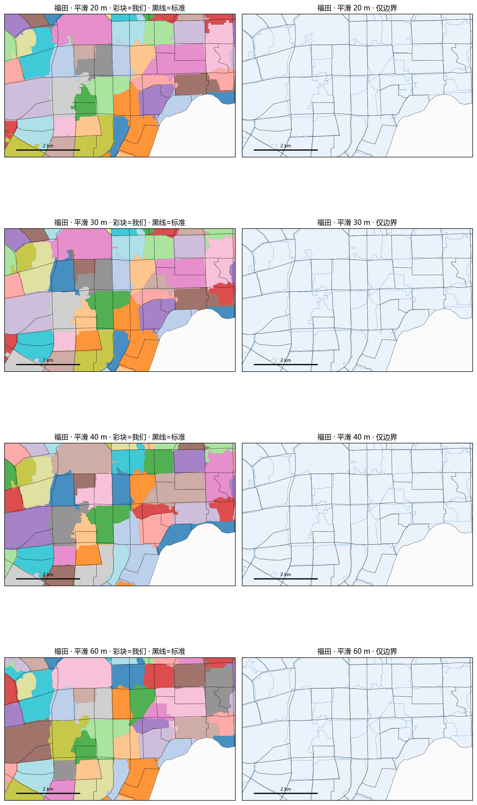

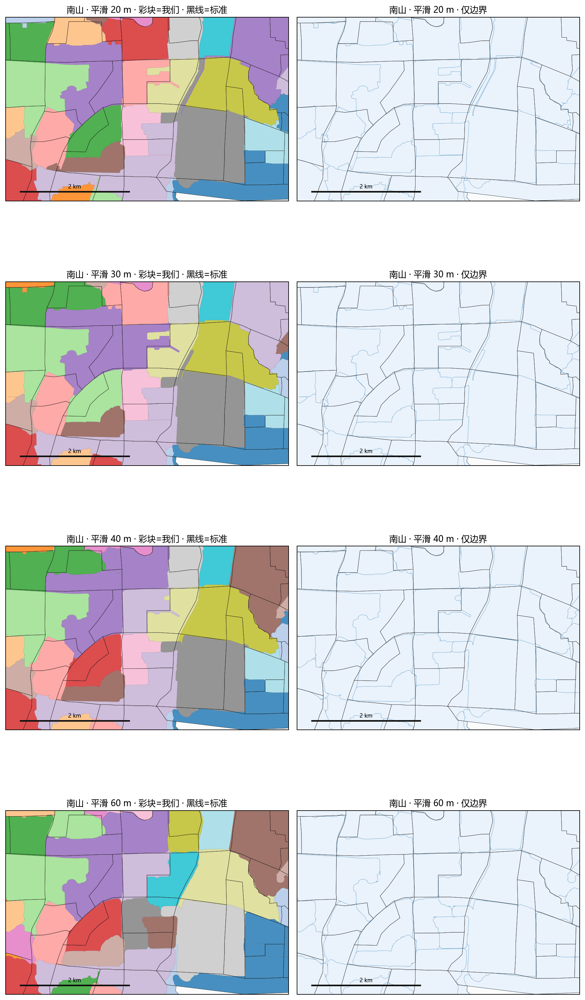

---

## 12. 阶段 9：OSM 命名

优先级：

1. 分区内的 `place` 地名点：neighbourhood > quarter > suburb > borough >
   village > hamlet > town > locality > city；
2. 分区内道路：major > secondary > tertiary > local > weak，且长度 ≥20 m；
3. 分区内 landuse/natural/water 面，占比 ≥2%（至少 1,000 m²）；
4. 800 m 内最近地名点；
5. 兜底：城市名 + 序号。

**具体例子**：一个分区内部有“华强北”这个 `place=neighbourhood` 点，就直接
叫“华强北”；没有地名点但边界沿“深南大道”，叫“深南大道”；内部是“莲花山
公园”的 landuse 面且面积足够大，叫“莲花山公园”；都没有但 800 m 内有
“车公庙”地名点，叫“车公庙”；再没有就退化成“深圳123”。同名会出现
“华强北（1）”“华强北（2）”，到省级聚合再变成“华强北·深圳”等。

同名：

```text
华强北（1）、华强北（2）……
省级聚合跨市重名：华强北·深圳、华强北·广州……
```

前端点击分区显示：名称、名称来源、面积、分区号。

---

## 13. 阶段 10：省级与扩展

### 13.1 省级

- 省域 ≤25,000 km²：一次性用省界推理；
- 更大省：按市/州逐个推理，结果裁到省界拼接；
- 广东 21 市：市级结果缓存在 `cache/province_agg/`，可续跑；
- 聚合时过滤 <1,000 m² 碎片，统一重编号，名称去重。

**具体例子**：广东全省陆地约 17.9 万 km²，远超 25,000 km²，所以选“广东”
不会把全省塞进一个任务，而是按深圳、广州、…、云浮 21 个市逐个推理，每个市
先得到自己的分区，再裁到省界拼起来。若换成北京（约 1.6 万 km²），就可以
用省界一次性推理。全国同理：按省/区域分开，不把全国几何一次性加载。

### 13.2 内存

- 数据构建/分区/聚合都按城市逐个处理；
- 训练加载 21 市 pairs 约 0.5 GB；
- XGBoost `hist` + `max_bin=64` + 4 线程，控制在数 GB；
- 全国部署按省/区域分别训练，不一次性加载全国几何。

### 13.3 全国

当前模型是广东 21 市训练；跨省是零样本。真正全国化需要按省份/区域重新
构建 pairs 并训练本地模型，复用同一套流程。

---

## 14. 逐阶段图：深圳坪山区

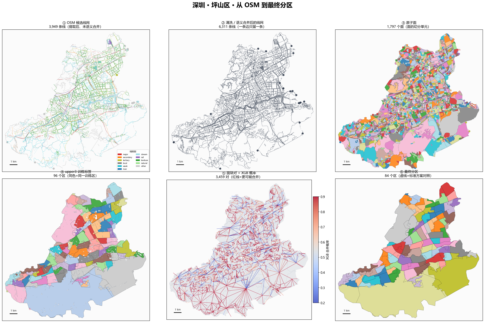

逐张看：

| 图 | 文件 | 看什么 |
|---|---|---|
| ① OSM 候选线 | `figures/pingshan_01_raw.png` | 看颜色：红=主干道、橙=次干道、灰=小区路、青=步道、蓝=水系、绿=用地边 |
| ② 清洗/语义合并 | `figures/pingshan_02_clean.png` | 线明显变少，双线/平行边消失 |
| ③ 原子面 | `figures/pingshan_03_faces.png` | 每个小色块是一个原子面 |
| ④ upper3 标签 | `figures/pingshan_04_labels.png` | 纯色块是训练区，黑色虚线是标准方案 |
| ⑤ XGB 面块对 | `figures/pingshan_05_pairs.png` | 每条线是一对相邻面，蓝→红表示合并概率升高 |
| ⑥ 最终分区 | `figures/pingshan_06_final.png` | 彩块是最终区，虚线是标准方案参考 |

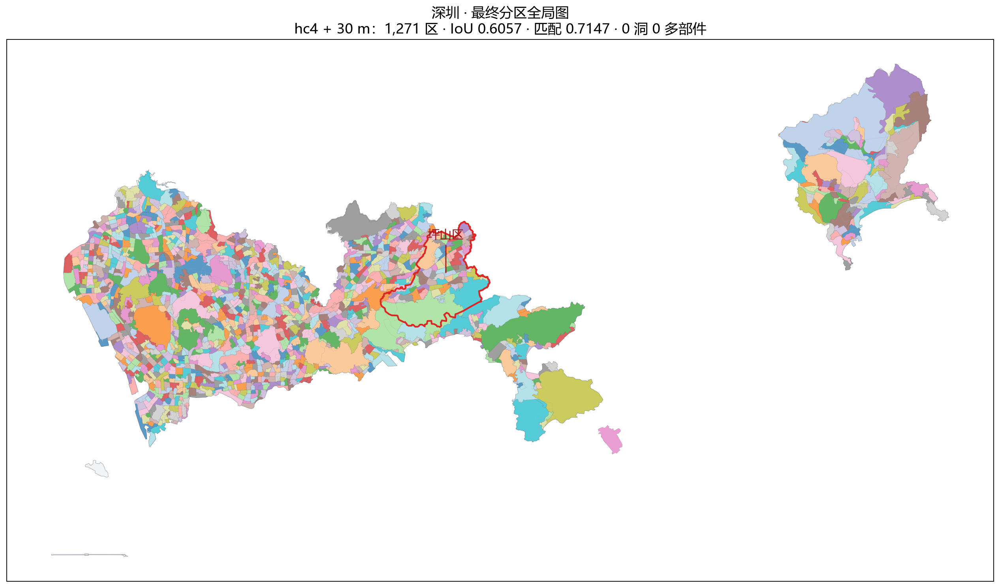

---

## 15. 逐阶段图：广州海珠区

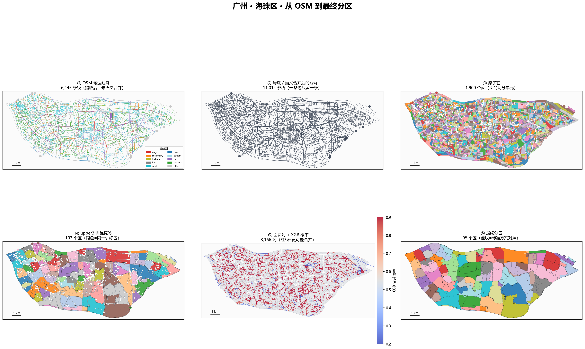

| 图 | 文件 |
|---|---|
| ① OSM 候选线 | `figures/haizhu_01_raw.png` |
| ② 清洗/语义合并 | `figures/haizhu_02_clean.png` |
| ③ 原子面 | `figures/haizhu_03_faces.png` |
| ④ upper3 标签 | `figures/haizhu_04_labels.png` |
| ⑤ XGB 面块对 | `figures/haizhu_05_pairs.png` |
| ⑥ 最终分区 | `figures/haizhu_06_final.png` |

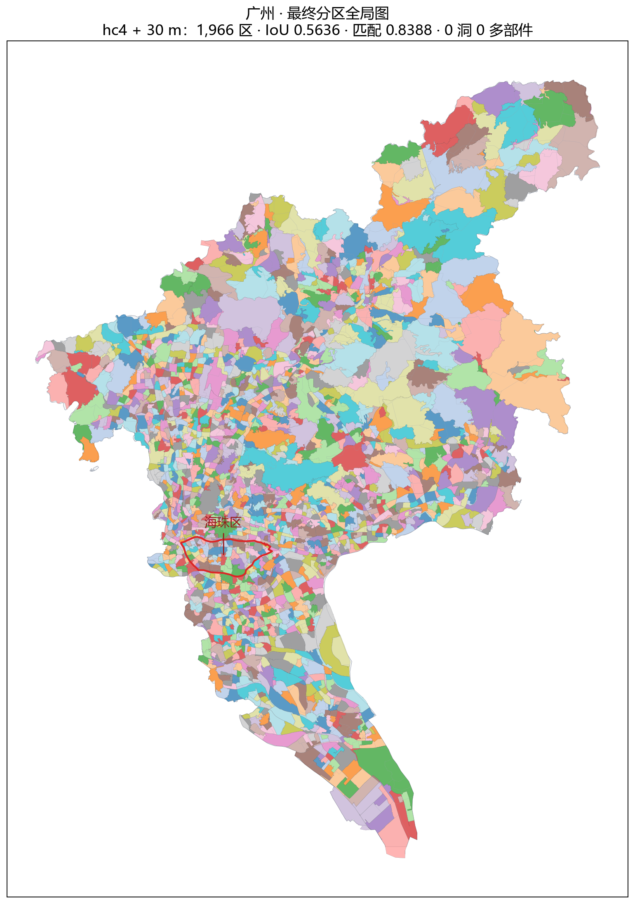

---

## 16. 历史验收图（深圳 1.3.0，60 m，档案对照）

> 当前交付的 5 市图（hc4 + 30 m）在
> `figures/final_cities_hc4_r30/`；下面这组图是 1.3.0 深圳单市验收版的
> 档案材料，指标为 1,470 区 / IoU 0.6677 / 匹配 0.8494 / 0 洞 0 多部件。

全链路阶段图：

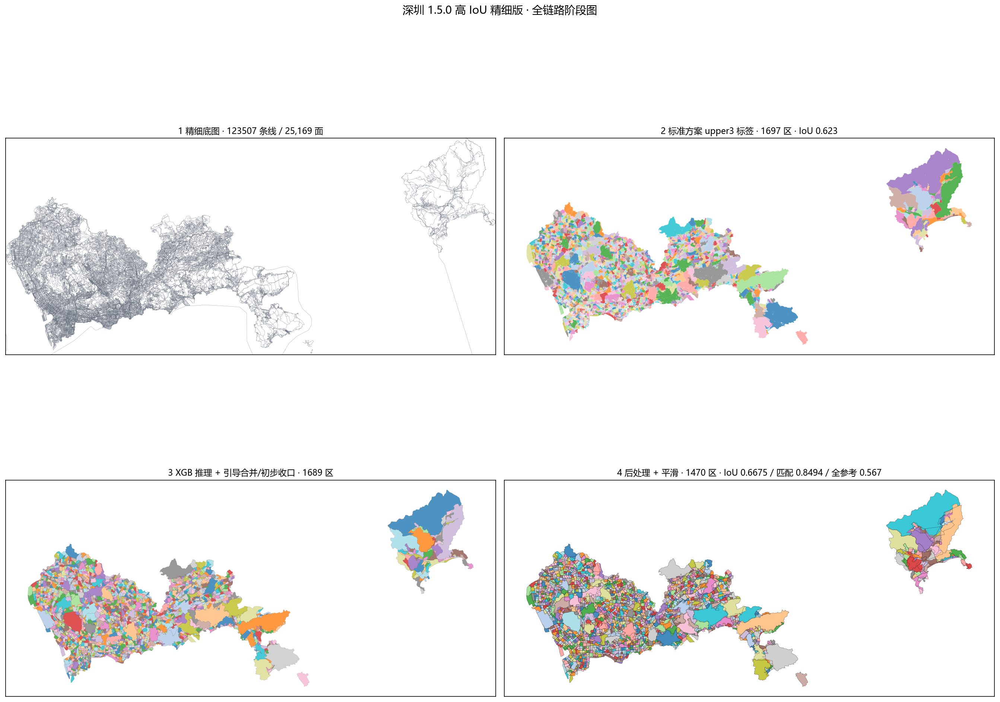

福田局部：

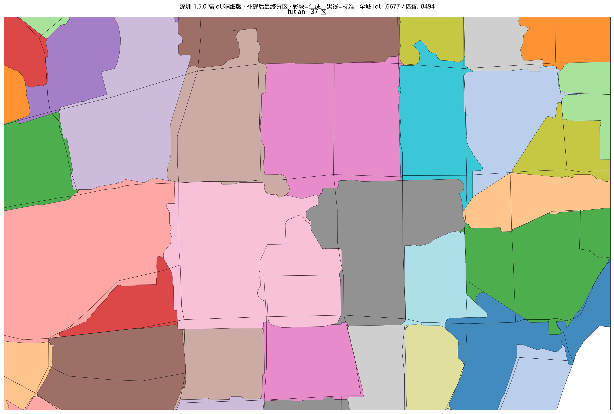

局部拼接 1：

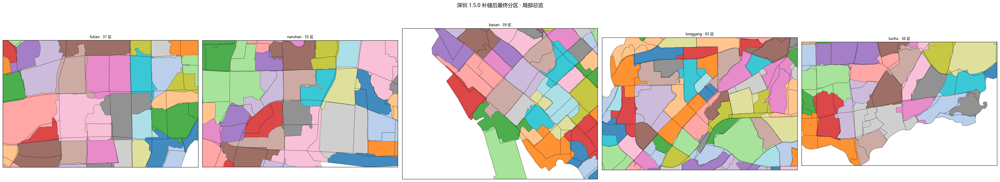

局部拼接 2：

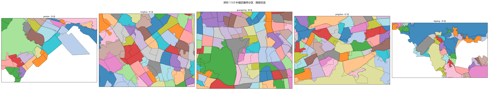

坪山局部：

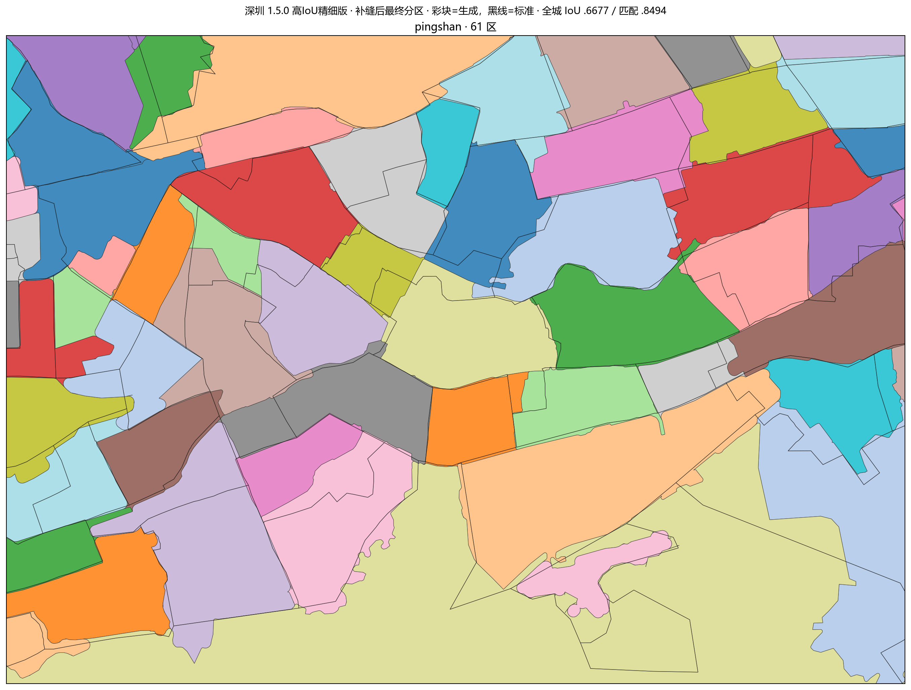

---

## 17. 当前算法工作状态

| 版本 | 状态 | 深圳指标（30 m 收口） |
|---|---|---|
| hc4 | **当前发布**，21 市统一旧范式底图（733,311 对） | 1,271 区 / IoU 0.6057 / 匹配 0.7147 / 0 洞 0 多部件 |
| hc2 | 历史版本，保留但不加载 | 约 1,459–1,470 区，IoU 0.6677（60 m） |
| hc3 | fresh 直连底图实验 | 1,250 区 / IoU 0.5457 / 匹配 0.7012，**不达标** |
| 旧范式链 | 已固化到 21 市训练数据 | 深圳 upper3 1,696 区 / IoU 0.5985 |

**结果定位**：历史 1.3.0 深圳单市验收基准为
`training/accepted/shenzhen_final3_filled_delivery.geojson`
（1,470 区 / IoU 0.6677 / 匹配 0.8494 / 全参考 0.5671）。hc4 是 21 市统一
部署模型，深圳指标低于该单市基准，但训练和推理不再依赖结果缓存、深圳
专属特征开关或预生成分区；5 市统一评估均为 0 洞/0 多部件。

hc4 + 30 m 逐市结果：

| 城市 | 区数 | IoU | 匹配率 | 全参考 IoU |
|---|---:|---:|---:|---:|
| 深圳 | 1,271 | 0.6057 | 0.7147 | 0.4329 |
| 广州 | 1,966 | 0.5636 | 0.8388 | 0.4728 |
| 佛山 | 1,340 | 0.5720 | 0.8749 | 0.5005 |
| 东莞 | 1,256 | 0.5377 | 0.8231 | 0.4426 |
| 珠海 | 455 | 0.6276 | 0.8513 | 0.5343 |

这 5 个城市都在训练集内，属于 in-sample 部署效果，不是城市留出泛化指标。

**前后端一致性**：FastAPI 的市/县/bbox/省级一次性生成，以及省级逐市聚合，
都走 `pipeline.runner` 的同一 profile（hc4 + 30 m）；前端任务完成状态会显示
模型名和收口半径。广东城市生成复用
`training/commercial_zoning/cache/province_1_5_0_legacy/<城市>/` 的训练同口径
底图（lines/faces/pairs + 配套 `eval_frame.geojson`，不是最终结果），与离线
评测图走完全相同的模型/合并/收口；珠海、广州逐区验证平均最佳 IoU 1.0000、
区数和指标完全一致。
县/区、bbox、省外走同一条 1.3.0 在线链（prepare_lines→aux→select→clean→
conflate→faces→pairs），不再使用简化重建。省级聚合的单市缓存带 `scheme`
（`uniform_cls2_v1|province_1_5_0_pbf_hc4|r30|prep_legacy_v1`）指纹，模型/半径/
预处理变化后旧缓存
不会被复用。清洗前后对比、候选线/标准方案评测、XGB 重要性/SHAP、参数消融
和省外示例见 `DEVELOPMENT_EVIDENCE.md`。

---

## 18. 复现命令（简版）

推理：

```bash
pip install -r requirements.txt
python run.py --port 8020
# 浏览器 http://127.0.0.1:8020/
```

训练/评估：

```bash
pip install -r requirements.txt -r training/requirements-train.txt
# 把 PBF 放 training/data/china/
# 把参考 CSV 放 training/aoi_zoning_delivery/data/reference/
bash training/scripts/run_province_1_5_0.sh
```

单市评估：

```bash
python training/tools/eval_uniform_city.py --city 深圳 \
  --pairs-dir training/commercial_zoning/cache/province_1_5_0_legacy \
  --model-dir training/commercial_zoning/models/province_1_5_0_pbf_hc4 \
  --reference training/aoi_zoning_delivery/data/reference/广东移动新版微网格20250420.csv \
  --finish-r 30 --out training/results/eval_sz_hc4_r30
```

旧范式底图重建：

```bash
python training/tools/build_legacy_substrate.py \
  --clean-dir aoi_release/commercial_zoning/cache/clean_lines_aux \
  --out training/commercial_zoning/cache/province_1_5_0_legacy \
  --pbf data/china/guangdong-260918.osm.pbf
```

---

## 19. 常见问题

**Q：为什么不用参考 CSV 直接生成分区？**  
A：参考方案是第三方数据，只能离线做标签/评估；线上推理必须只依赖 OSM。

**Q：为什么不用人工规则直接切？**  
A：单靠道路等级无法表达“街区完整性、POI 密度、用地连续性”，XGB 学的是
这些组合信号；后处理再保证拓扑可交付。

**Q：为什么弱路这么多还要保留？**  
A：参考方案在城区把小区路、步道、宗地边当边界；删掉会损失大量真实边界。

**Q：为什么要有 upper3？**  
A：最大重叠会产生标签孤岛，模型学不连续；upper3 让训练目标连续。

**Q：为什么 30 m 平滑不会把小区并掉？**  
A：它是形态学开闭运算，主要去毛刺/填小凹口；大边界和主要结构保留。
真正的合并由 XGB 概率和引导合并决定。

**Q：为什么深圳要锚定旧 1.3.0 底图？**  
A：这是验收结果的来源；旧底图的标签质量（upper3 IoU 0.623）高于当前链的
0.5985。其他城市用同一旧范式链生成，保证方法统一、可扩展。

---

> 公式、逐特征解释、阈值表和代码位置集中在
> `FEATURES_AND_THRESHOLDS.md`；本文只讲流程和动作含义。

# 附录：这些算法动作到底意味着什么

这一节不讲“调用哪个函数”，而讲**每一步在现实地图上意味着什么、为什么必须做、
不做会怎样**。

## D.1 为什么先“洗线”再“切面”

把 OSM 线网想成一张手绘草图：

- 同一条路可能被画了两遍；
- 主干道旁边可能还有一条同名辅路，隔 6 m；
- 小区的 landuse 边可能沿着道路画，隔 8 m；
- 很多线在路口断着，没有真正接上；
- 有些线只有几米长，是画图残留。

如果直接把这张草图当“刀”去切城市，会切出大量 5–10 m 宽的细长面。
这些面不是真实街区，但会变成训练样本，模型会被迫学习“这些假碎面要不要
合并”，既慢又容易学错。

所以顺序必须是：

```text
先修刀（线网清洗） → 再切面 → 再判断面块对
```

## D.2 “去重”到底去的是什么

去重不是“看到平行线就删”。它区分三种情况：

1. **同 name/同 ref 的重复线**：10 m 带内视为同一特征，删低优先级重合段；
2. **不同名/无名线**：只有 ≤2 m 近重合才删；5–10 m 的平行线可能是两条
   真实街巷/宗地，不能硬并；
3. **线段级扣除**：只删两条线重合的那一段，不整条删除，避免破坏整条道路。

例子：一条主干道旁 6 m 有一条同名辅路，辅路和主干道有 300 m 重合。
去重后辅路只在重合段消失，两端保留；不是把辅路整条删掉。

**如果不做/做过头**：

- 不做：面网出现大量双线夹出的细长面；
- 做过头（把 5–10 m 不同名街巷硬并）：会丢掉真实边界，参考方案中的小区
  边界可能直接消失。

## D.3 “断点修复”在修什么

OSM 的线经常在路口、桥、隧道、编辑断点处断开。多边形化要求线网闭合，
否则会漏面或把两个面错误连在一起。

断点修复就是：

```text
找到悬空的线头 → 在 80 m 内找最近的线 → 补一条短连接
                  → 找不到再放宽到 300 m
```

补出来的线继承原来线的类别。它像“把草图的断线用铅笔接上”，不是随便拉长。

**如果不做**：线网不闭合，面网会出现漏面、超长面，甚至把整片区域当成一个面。
**如果修得太长**：会生成大量“蛛网”连接线，增加假边界，所以旧链限制在
80/300 m 两档。

## D.4 “语义合并”解决什么问题

几何去重只能看出“两条线位置很近”；语义合并还能看出“这两条线表达的是
同一条边界”。

典型情况：

- 道路和 landuse 边只隔 8 m，实际是同一条小区边界；
- 相邻两个 landuse 面共享一条边，画了两遍；
- 行政界重复画了两次；
- 铁路场里有多股平行道。

语义合并按优先级保留“更像边界”的那条：

```text
基础设施线（道路/铁路/水系/行政）优先于面积边（landuse/natural/POI）
```

**如果不做**：同一条边界会出现两条线，切面时中间夹出一条细缝；模型会看到
不该存在的面块对。**如果合并太狠**：会把真实的两条街巷并成一条，丢掉参考
方案里的边界。因此不同名线只允许 ≤2 m 近重合。

## D.5 “原子面”是什么，为什么需要它

原子面就是**线网切出来的最小封闭块**，不能再被内部线切开。

可以把它想成拼图的单块：后面所有判断都是“这两块拼图要不要拼在一起”。

原子面需要满足：

- 由线网和城市陆域边界围成；
- 面积 ≥10,000 m²；
- 不在海里；
- 几何有效。

**为什么不能直接用道路围成的街区？** 因为一条 landuse 边、一条小河、一条
铁路也可能把街区切开；原子面把所有这些边界都考虑进去，是后续合并的最小单位。

## D.6 upper3：把“标签孤岛”变成连续训练区

如果只按“原子面与哪个参考格重叠最大”赋标签，会出现：

```text
一个小区被周围另一个参考区包围 → 它被赋成周围那个区
但小区内部可能又包含另一个参考格 → 形成标签孤岛
```

标签孤岛会让模型困惑：它看到一块面，周围都该合并，但它自己标签不同。

upper3 的做法像“水从最大连通块往外渗”：

1. 每个参考格的最大连通块先当种子；
2. 未标注的面看邻居：
   - 邻居和自己同 ref → 优先；
   - 否则看与自己参考格重叠面积；
   - 再否则看共享边长度；
3. 迭代到稳定；
4. 完全孤立的细面按最近已标注面兜底。

结果：训练标签连续、连通，模型学到的是“整块街区”的边界，而不是零散孤岛。

**注意**：upper3 只用参考 CSV 做离线标签；在线推理没有 ref_id，也不读 CSV。

## D.7 为什么用“面块对”而不是“单面分类”

单看一个面，很难回答“它该不该和邻居合并”。必须看**两块面之间的关系**：

- 中间隔的是主干道还是小区路？
- 共享边 20 m 还是 200 m？
- 两块面面积是否悬殊？
- 两侧 POI/用地密度是否相似？
- 它们在面网里是不是同一个“社区”（共同邻居多不多）？

所以把每对相邻面变成一行 90 维特征，让 XGB 判断“这两块是否属于同一微网格”。

## D.8 XGBoost 在做什么：不是规则表，是很多棵树的投票

XGBoost 是梯度提升树：

- 每棵树看若干个特征，做类似这样的判断：
  - `border_m > 120`？
  - `bf_major < 0.2`？
  - `a_poi_density` 和 `b_poi_density` 是否接近？
- 每棵树输出一个分数；
- 12,000 棵树加起来，再经过 sigmoid，得到 0–1 的合并概率。

它不会输出“因为边界 86 m 所以合并”这样的解释；它学的是特征组合。
这也是为什么需要 90 个特征覆盖几何、边界、邻域、用地、POI 多个角度。

**概率不是面积，也不是 IoU。** 高概率只表示“模型认为该合并”，还需要外部
阈值、引导合并和后处理。

## D.9 阈值 0.8 + 并查集：把概率变成“一伙一伙”

先把每个原子面当成独立集合，然后：

```text
若 p >= 0.8，就把两块面的集合合并（union）
```

并查集负责高效维护“谁和谁已经是一伙”。最后每个集合就是一个初始分区。

阈值的作用：

- 0.8 很高 → 只合并非常确定的边 → 初始区很碎；
- 0.5 很低 → 合并更多 → 容易过并成大区；
- 0.8 是验证/阈值扫描选出的操作点，不是模型内部参数。

## D.10 引导小区块合并：把“碎渣”并回合理邻居

阈值 0.8 会产生很多 <0.6 km² 的小区。它们不是错，但太碎，不符合微网格尺度。

做法：对每个小分区，看所有邻居，挑“最强边”：

```text
先看最大 XGB 概率
再看按共享边长度加权的平均概率
再看邻居面积
```

只有最大概率 ≥0.5 且合并后 ≤40 km² 才合并；一轮不够就多轮。

直观例子：

- 区 A 0.2 km²、区 B 0.3 km²，共享边概率 0.86 → 合并成 0.5 km²；
- 区 C 和小区的最大边概率只有 0.42 → 保留，不硬并。

这一步是“按 XGB 语义补足面积”，不是按几何最近随便并。

## D.11 碎块吸收：处理“半块以下”的碎屑

吸收阈值 0.3 km² 比引导目标 0.6 更小，专门处理：

- 被主干道/河流夹出的边角料；
- 补缝后产生的小碎片；
- 引导合并后仍小于半块的面。

吸收时优先并到共享边界最长的邻居，并且要求并集是单个有效 Polygon。
**吸收不是重新分区**，它只处理小碎块，尽量不动已经合理的大区。

## D.12 30 m 精细收口：修边，不是重新切

`refine_best` 做的是形态学开闭运算：

```text
先 buffer(-30) 缩进去：去掉毛刺、细颈、尖角
再 buffer(+30) 长回来：填平小凹口
```

它像“用圆角橡皮把分区边缘修顺”，不会把两个大区合并，也不会改变主要边界。

然后：

- 消重叠；
- 补缝；
- 多部件拆分：主块保留，>0.15 km² 的分离块提升为独立区；
- 被包围的飞地并入宿主；
- 清洞、单部件；
- 直到 0 洞/0 多部件。

为什么是 30 m？在深圳用 hc4 比较 20/30/40/60 m：四档 IoU、匹配率几乎
相同，但 60 m 把大量小直角抹成圆弧，40 m 已明显偏离标准方案，20 m 仍
保留细碎波动；30 m 兼顾整洁和保真，因此作为交付口径。这是验证选择，
不是公式。

## D.13 补缝与 Voronoi：把“没人管的地”分给邻居

补缝处理城市范围内没有被任何分区覆盖的缝隙。

- 小缝：并到共享边界最长的邻居；
- 复杂/环状缝：不能整块塞给一个区，否则会把其他区包成洞；
  这时用 Voronoi 按最近分区切开，再分别并给邻居；
- 并集必须保持单 Polygon、面积可加、不产生新洞。

阈值：

- 缝隙面片 ≥1 m²；
- 共享边 >0.1 m 才算贴边；
- 并集面积误差 <1 m²；
- 复杂缝最多取前 64 个候选做 Voronoi。

## D.14 命名：让分区从“编号”变成“地名”

没有命名时，分区只能叫“深圳123”。命名模块从 OSM 取：

- 分区内地名点（小区/村/片区）；
- 分区内道路名；
- 分区内 landuse/natural/water 名称；
- 800 m 内最近地名；
- 兜底“城市+序号”。

同名加（1）（2）；省级聚合时再追加城市名。

**名字只是展示**，不参与 XGB 概率、合并和后处理。

## D.15 参考方案为什么只能离线用

参考 CSV 是第三方标准方案：

- 训练时用它生成 `ref_id` 和 upper3 标签；
- 评估时用它算 IoU/匹配率；
- **在线推理不读它**，也不把参考格当种子。

如果在线读参考方案，就是数据泄漏，结果会虚高，不能交付。

---

# 结语：一句话总结

```text
洗线 → 切面 → 打标签 → 提特征 → XGB 判断 → 阈值合并
→ 引导补面积 → 吸收碎块 → 30 m 修边 → 补缝 → 命名
```

每个动作都有明确的“如果不做会怎样”；每个特征都在回答两块面之间的一个
具体问题。把这些动作和特征串起来，就是完整的 FineGrid-XGB 1.5.0。
