# 算法开发证据：困难、做法与评测

本文用图和数字回答几个问题：

1. 原始 OSM 线网有多乱，清洗后干净了多少？
2. 为什么选这 13 类 OSM 特征线作为候选边界？它们和移动标准方案的关系如何？
3. 标准方案里有多少边界在 OSM 中根本不存在？
4. 为什么需要 upper3 连续标签、后处理、30 m 收口、阈值 0.8、引导合并和吸收？
5. XGBoost 模型内部真正依赖哪些特征？
6. 省外零样本效果如何？

所有评测数据、脚本和图片都在本交付文件夹内：

```text
docs/algorithm_guide/analysis/            评测图片、JSON/CSV
docs/algorithm_guide/analysis_*.py         评测/画图脚本
training/results/city_hc4_r30/             5 市 hc4 + 30 m 评测
training/results/stages/                   分区各阶段快照与指标
training/results/ablations/                阈值/参数消融
training/results/outside/                  省外零样本结果
```

---

## 1. OSM 数据清洗：从“乱线团”到可切分的底图

原始候选线来自本交付文件夹的广东 PBF，按 13 类 OSM 边界特征抽取；随后做
线段级去重、断点修复、语义合并（`select → clean → conflate`）。这一步只
保留“一条边一条线”，为后续多边形化和特征计算提供干净底图。

| 城市 | 清洗前线数 | 清洗前总长 | 清洗后线数 | 清洗后总长 | 线长压缩 |
|---|---:|---:|---:|---:|---:|
| 深圳 | 213,197 | 123,682.6 km | 123,507 | 29,715.5 km | **76.0%** |
| 广州 | 221,108 | 159,687.4 km | 176,346 | 55,868.0 km | **65.0%** |

线数不一定下降：语义合并会按类别把一条“混装”线拆成语义完整的线，因此
局部线数可能增加；**总长度**才反映重复线、平行双线、碎线被去除的程度。

局部前后对比（左=清洗前，中=清洗后，右=标准方案边界覆盖，绿=OSM 有线、
红=OSM 无对应线）：

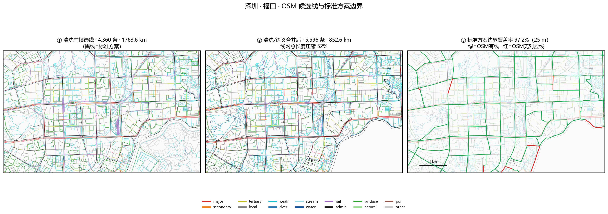

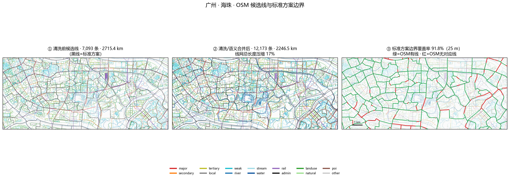

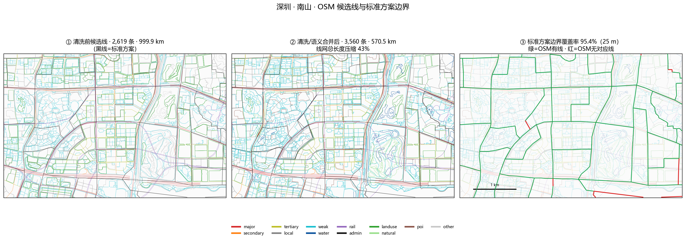

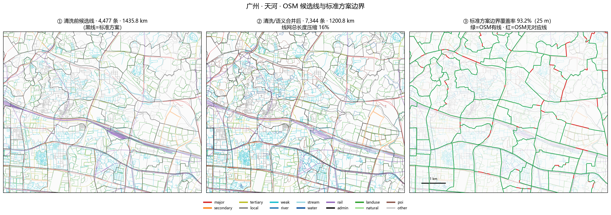

| 局部 | 清洗前 | 清洗后 | 线长压缩 | 标准方案边界 25 m 覆盖率 |
|---|---:|---:|---:|---:|
| 深圳福田 | 1,763.6 km | 852.6 km | 51.7% | 97.2% |
| 深圳南山 | 999.9 km | 570.5 km | 42.9% | 95.4% |
| 广州海珠 | 2,715.4 km | 2,246.5 km | 17.3% | 91.8% |
| 广州天河 | 1,435.8 km | 1,200.8 km | 16.4% | 93.2% |

中心城区 OSM 本身已经较完整，去重幅度小于全市（全市含大量郊区重复线）；
但视觉上“平行双线、断头、过密细线”明显减少，线网从“毛糙”变为可切分的
骨架。深圳原始数据中还有约 4.8 万 km 的 `other`（无有效边界标签的线，如
围栏、电力线等），候选选择阶段会剔除，不参与分区。

---

## 2. 为什么选这 13 类 OSM 特征线

候选类别：`major / secondary / tertiary / local / weak / river / stream /
water / rail / admin / landuse / natural / poi`。判定依据不是“看起来像”，
而是把它们与移动标准方案的边界逐段比较：

- **覆盖率**：标准方案边界上每 20 m 取一个采样点，看最近 OSM 线在多少米内；
- **单独覆盖**：只看某一类线时，能解释多少标准方案边界；
- **精度**：每条 OSM 类线采样后，有多少比例落在标准方案边界 25 m 内。

深圳结果（容差 25 m）：

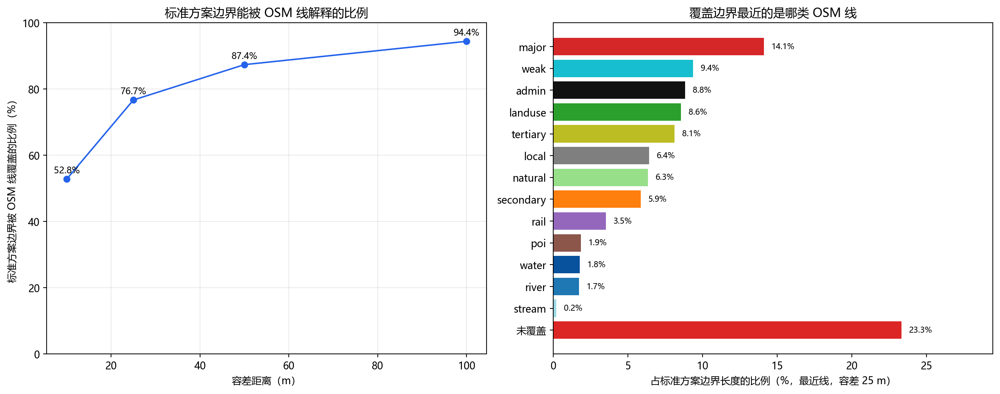

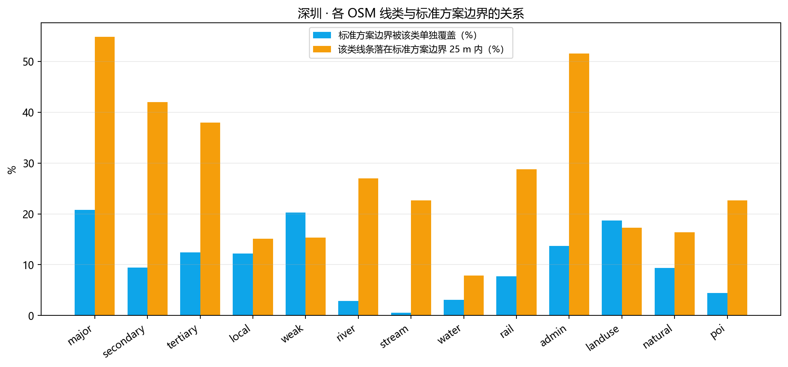

| 类别 | 单独覆盖标准边界 | 线条落在标准边界 25 m 内 | 作为最近线的占比 |
|---|---:|---:|---:|
| major | 20.8% | **54.8%** | 14.1% |
| weak | 20.3% | 15.3% | 9.4% |
| landuse | 18.7% | 17.3% | 8.6% |
| admin | 13.7% | **51.5%** | 8.8% |
| tertiary | 12.4% | 38.0% | 8.1% |
| local | 12.2% | 15.1% | 6.4% |
| natural | 9.4% | 16.4% | 6.3% |
| secondary | 9.5% | 42.0% | 5.9% |
| rail | 7.8% | 28.8% | 3.5% |
| poi | 4.4% | 22.7% | 1.9% |
| water | 3.1% | 7.8% | 1.8% |
| river | 2.9% | 27.0% | 1.7% |
| stream | 0.6% | 22.7% | 0.2% |
| 未覆盖 | — | — | **23.3%** |

结论：

1. **所有 13 类都有贡献。** 主干道覆盖最多，但只靠主干道会漏掉大量
   小区级边界；`weak/local/landuse/natural` 单独精度不高，却覆盖了标准
   方案中大量“非干道”边界，去掉会直接降低覆盖率。
2. **行政界和用地边是重要补充。** `admin` 的精度 51.5%，`landuse` 单独
   覆盖 18.7%；它们在道路网稀疏的郊区、园区、海岸线附近提供边界。
3. **水系/铁路/POI 是少数但不可替代的特征。** 覆盖率低，却在跨江、铁路
   走廊、大型宗地等位置给出别处没有的边界。
4. 合并所有类别后，深圳标准方案边界在 **25 m 内覆盖 76.7%**、50 m 内
   87.4%、100 m 内 94.4%；广州分别为 62.3%、74.1%、84.3%。

---

## 3. 标准方案中“OSM 根本没有”的边界

把容差放宽仍无法解释的边界，就是 OSM 没有对应线的部分：

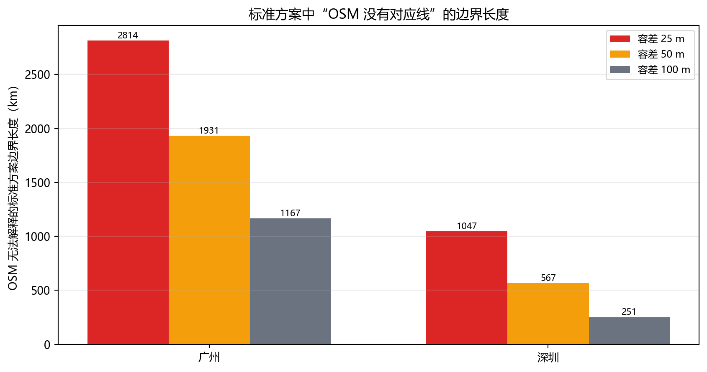

| 城市 | 25 m 容差未覆盖 | 50 m 未覆盖 | 100 m 未覆盖 |
|---|---:|---:|---:|
| 深圳 | 1,046.7 km（23.3%） | 567.3 km（12.6%） | **251.4 km（5.6%）** |
| 广州 | 2,814.0 km（37.8%） | 1,931.4 km（25.9%） | **1,167.4 km（15.7%）** |

即使容差放到 100 m，深圳仍有约 251 km、广州约 1,167 km 标准方案边界在
OSM 中找不到对应线。这些边界主要来自：

- 标准微网格包含的宗地边、院墙、内部道路、建筑轮廓等 OSM 未测绘要素；
- 两家数据生产的时间差和几何位置差（OSM 偏移、简化、合并）；
- 参考方案使用的行政/规划界线与 OSM 边界不完全同源；
- 海岸线、滩涂、水域等自然边界的表达方式不同。

这解释了为什么最终 IoU 不可能接近 1：**输入 OSM 本身缺失了部分参考边界**。
剩余误差里，有一部分是模型可改进的，另一部分是数据源上限。上图中红色
短段就是当前局部区域里 OSM 无法解释的部分；它们也是后续 IoU 误差的主要
来源之一。

---

## 4. 为什么需要 upper3 连续标签

直接用“最大重叠参考格”给原子面打标签，会让一个小面被周围另一个参考格
包围，形成大量“标签孤岛”。对比深圳：

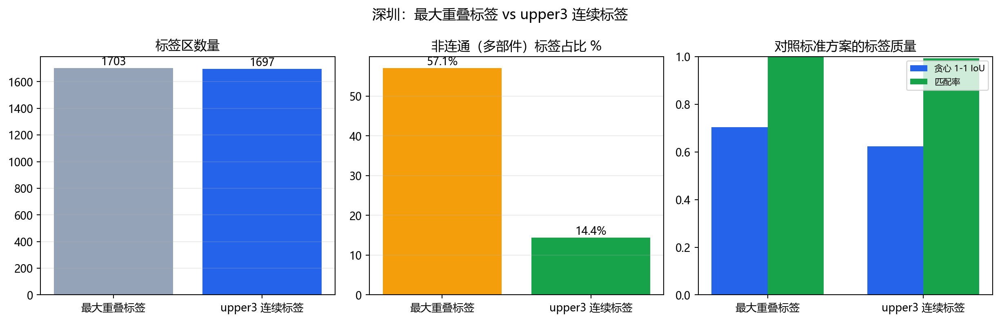

| 标签 | 区数 | 多部件（不连通）占比 | 贪心 1-1 IoU | 匹配率 |
|---|---:|---:|---:|---:|
| 最大重叠标签 | 1,703 | **57.1%** | 0.7034 | 0.9977 |
| upper3 连续标签 | 1,697 | **14.4%** | 0.6230 | 0.9936 |

最大重叠标签对参考方案“拟合”更紧（IoU 0.7034），但 57% 的标签区是
不连通的碎片，模型很难从相邻面特征里学出这种跳跃。upper3 用 0.08 的标签
IoU 换取空间连续性，把不连通标签降到 14.4%；最终 hc4 模型输出 IoU 0.6057，
已经接近 upper3 标签上限 0.6230 的 97%。这说明当前误差主要来自标签/数据
上限，而不是模型完全没学到。

---

## 5. 后处理前后：为什么必须吸收、补缝、清洞、收口

分区草稿（XGB 阈值合并 + 引导合并）会有大量空洞、缝隙和碎块；后处理与
30 m 收口把它们修成可交付的拓扑。深圳、佛山对比：

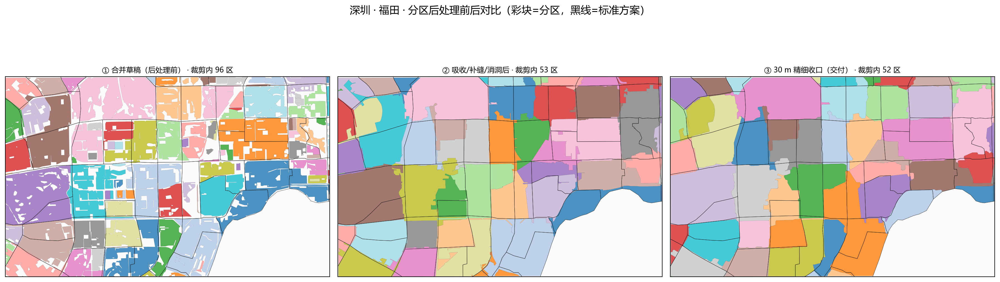

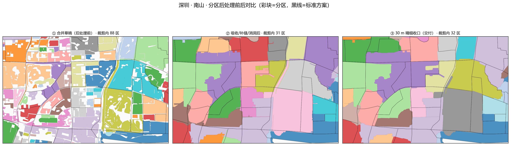

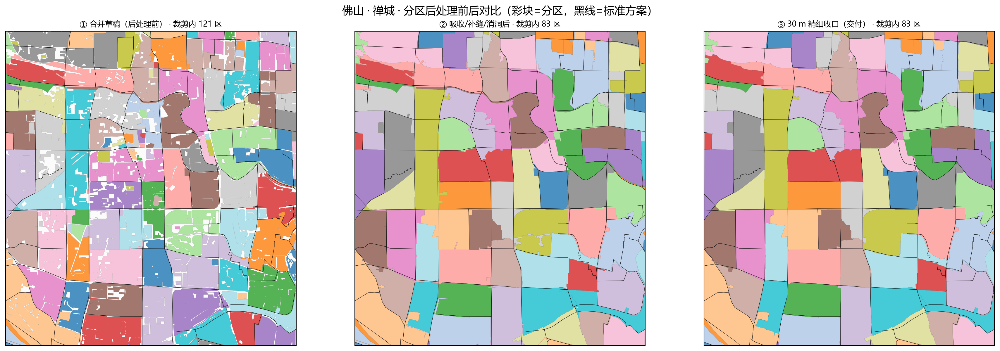

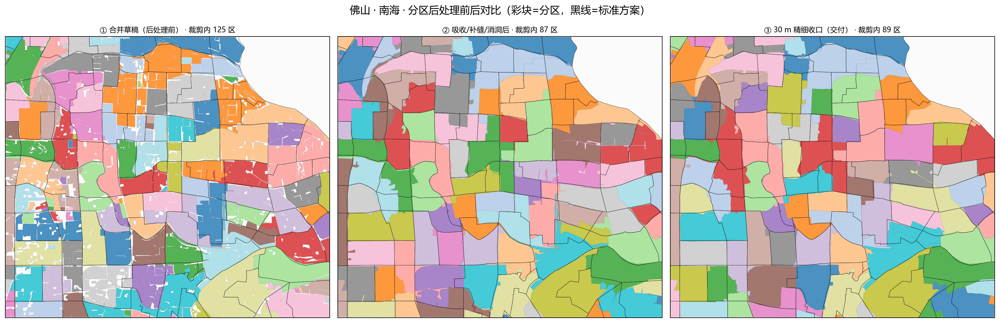

城市级指标（`training/results/stages/stage_metrics.json`）：

| 城市/阶段 | 区数 | 缝隙 km² | 洞 | 多部件 | 面积中位 km² | IoU | 匹配率 | 边界 F1 |
|---|---:|---:|---:|---:|---:|---:|---:|---:|
| 深圳·草稿 | 1,751 | **110.897** | **13,864** | 0 | 0.681 | 0.5493 | 0.7768 | 0.4513 |
| 深圳·吸收/补缝后 | 1,248 | 0.001 | **0** | 0 | 0.998 | 0.6012 | 0.7071 | **0.4880** |
| 深圳·30 m 收口 | 1,271 | 0.005 | 0 | 0 | 0.991 | **0.6057** | 0.7147 | 0.4742 |
| 佛山·草稿 | 1,514 | **95.266** | **12,668** | 0 | 1.399 | 0.5400 | 0.8993 | 0.3771 |
| 佛山·吸收/补缝后 | 1,310 | 0.001 | **0** | 0 | 1.657 | 0.5677 | 0.8733 | 0.4077 |
| 佛山·30 m 收口 | 1,340 | 0.006 | 0 | 0 | 1.627 | **0.5720** | 0.8749 | 0.4004 |

草稿在深圳留下 110.9 km² 的缝隙（约占全市 4.5%）和 13,864 个空洞，
直接交付会像“筛子”；吸收 504 个碎块、补缝、清洞后，缝隙降到 0.001 km²、
洞归零，IoU 从 0.5493 提升到 0.6012。30 m 收口再略微提高 IoU/匹配率，
并把边界修顺；边界 F1 有小幅回落（0.4880→0.4742），这是“更规整”与
“更贴原始锯齿边”的取舍。

平滑半径对比（深圳，hc4，只改 `refine_best` 半径）：

| 半径 | 区数 | IoU | 匹配率 | 全参考 IoU | 边界 F1 |
|---:|---:|---:|---:|---:|---:|
| 20 m | 1,263 | 0.6055 | 0.7124 | 0.4313 | 0.4766 |
| **30 m** | **1,271** | **0.6057** | **0.7147** | **0.4329** | **0.4742** |
| 40 m | 1,275 | 0.6042 | 0.7159 | 0.4325 | 0.4746 |
| 60 m | 1,272 | 0.6049 | 0.7147 | 0.4323 | 0.4747 |

20 m 保留细节但边缘有细碎波动；60 m 把小直角抹成圆弧，视觉过度平滑；
30 m 在指标不降的前提下最整洁，因此作为交付半径。逐半径局部图见
`figures/smooth_compare/`。

---

## 6. XGBoost 到底看哪些特征

直接读取 hc4 模型内部：82/90 个特征实际参与分裂（8 个建筑特征恒为 0），
总 gain 509.3。另从 5 个城市抽 4,000 对面块对（高概率 2,732 对、低概率
241 对）计算 SHAP 贡献。

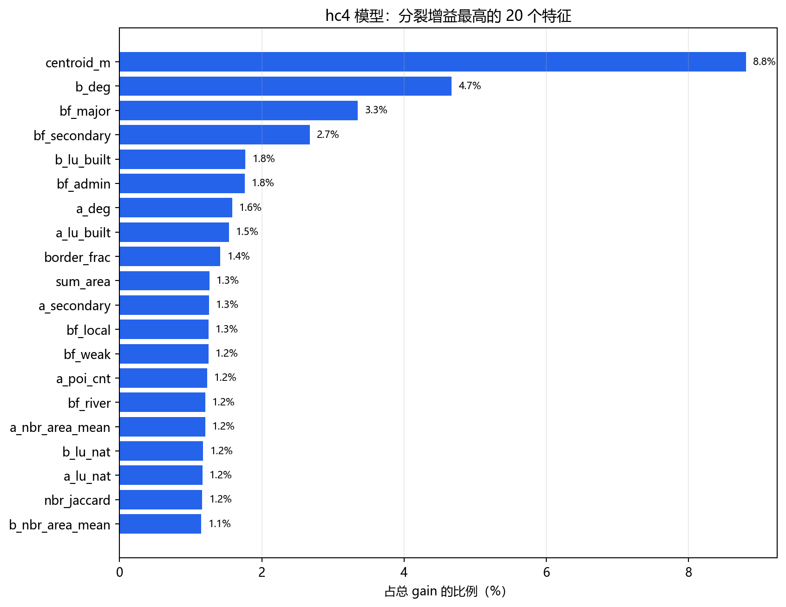

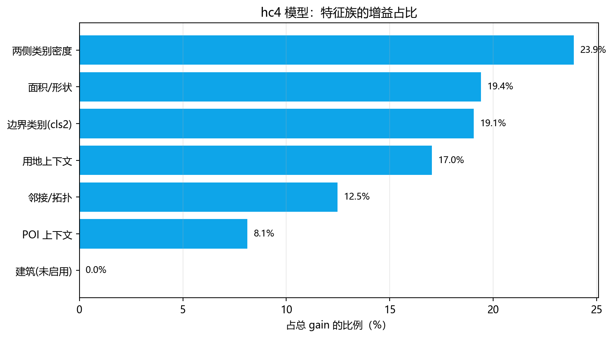

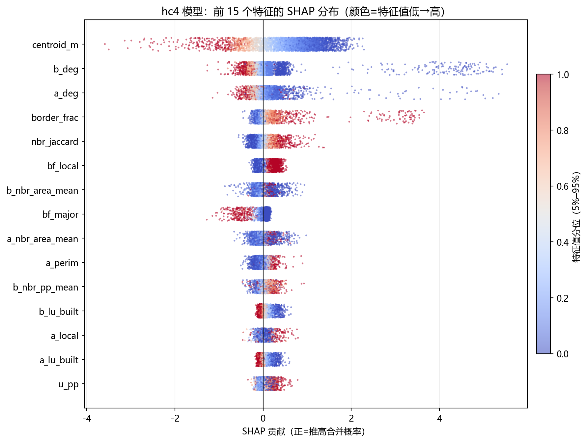

增益前 10 名：

| 排名 | 特征 | gain 占比 | 含义 |
|---:|---|---:|---|
| 1 | `centroid_m` | 8.8% | 两块面质心距离 |
| 2 | `b_deg` | 4.7% | B 面在邻接图中的度（接了多少个面） |
| 3 | `bf_major` | 3.3% | 共享边中主干道类边界的比例 |
| 4 | `bf_secondary` | 2.7% | 共享边中次干道比例 |
| 5 | `b_lu_built` | 1.8% | B 面邻域建设用地占比 |
| 6 | `bf_admin` | 1.8% | 共享边中行政界比例 |
| 7 | `a_deg` | 1.6% | A 面的邻接度 |
| 8 | `a_lu_built` | 1.5% | A 面建设用地占比 |
| 9 | `border_frac` | 1.4% | 共享边占小面周长的比例 |
| 10 | `sum_area` | 1.3% | 两面的面积和 |

特征族占比：

| 特征族 | 特征数 | gain 占比 |
|---|---:|---:|
| 两侧类别密度（道路/水系/铁路/用地等） | 24 | 23.9% |
| 面积/形状 | 12 | 19.4% |
| 边界类别 `cls2` | 14 | 19.1% |
| 用地上下文 | 16 | 17.0% |
| 邻接/拓扑 | 8 | 12.5% |
| POI 上下文 | 8 | 8.1% |
| 建筑（未启用） | 8 | 0.0% |

高/低合并概率样本的特征中位数（SHAP 也给出相同方向）：

| 特征 | 高概率（≥0.8） | 低概率（≤0.2） | 解读 |
|---|---:|---:|---|
| `centroid_m` | 274.6 m | 1,159.8 m | 越近越该合并，距离是第一信号 |
| `a_deg` | 5 | 12 | 处在复杂路口/多面交点的面更少合并 |
| `b_deg` | 4 | 7 | 同上 |
| `border_frac` | 0.269 | 0.093 | 共享边占小面周长越大越该合并（深度贴合） |
| `u_pp` | 0.253 | 0.080 | 合并后整体越紧凑越该合并 |
| `bf_local` | 0.118 | 0.000 | 共享边含小区路时更可能沿它合并 |
| `a_area` | 0.062 km² | 0.489 km² | 高概率对里常有待吸收的小面 |

结论：

- 模型首先学的是**空间邻近 + 深接触 + 合并后形状紧凑**，与“分区应该
  是紧凑街区”的直觉一致；
- **道路等级/行政界/用地边**共同决定“哪里该停”：主干道、次干道、行政界
  比例高时更倾向不合并；小区路/内部路则允许合并；
- **上下文特征合计约 40%**（用地 17% + POI 8% + 两侧类别密度中非边界部分），
  说明只靠几何不够，OSM 语义确实被模型使用；
- 8 个建筑特征完全未启用，模型实际使用 82/90 个特征；这与“省内存、
  建筑数据覆盖不稳定”的工程取舍一致。

注意：gain/SHAP 是相关性和使用频率，不是因果证明；相关特征会分摊重要性，
所以表中同时给出特征族占比和方向，而不是只报单个特征排名。

---

## 7. 阈值、引导合并、吸收的消融

全部在深圳、hc4、30 m 收口下进行，只改一个参数：

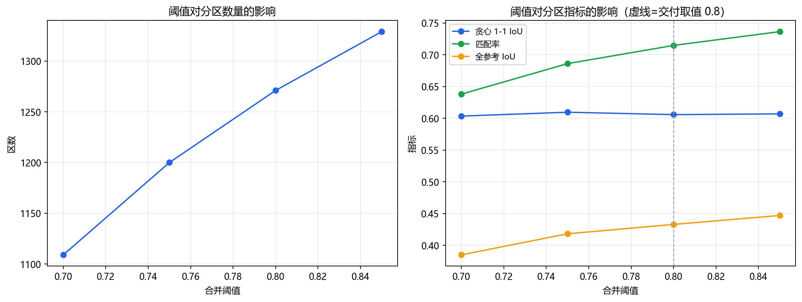

| 阈值 | 区数 | IoU | 匹配率 | 全参考 IoU | 边界 F1 |
|---:|---:|---:|---:|---:|---:|
| 0.70 | 1,109 | 0.6034 | 0.6380 | 0.3850 | 0.4760 |
| 0.75 | 1,200 | **0.6095** | 0.6860 | 0.4181 | **0.4789** |
| **0.80（交付）** | **1,271** | 0.6057 | 0.7147 | 0.4329 | 0.4742 |
| 0.85 | 1,329 | 0.6069 | **0.7364** | **0.4469** | 0.4720 |

阈值越低，合并越激进：0.70 只剩 1,109 区，匹配率掉到 0.638，全参考 IoU
掉到 0.385；说明大量参考格被过度合并。阈值越高，区越多、匹配率越高，
但过分割风险增加。0.80 的区数（1,271）和参考格（1,707）处于合理区间，
匹配率/全参考 IoU 比 0.70/0.75 明显更稳；0.85 在深圳单市略高，但只多出
58 个区（+4.6%）、边界 F1 更低，属于同一可调区间。交付保持历史统一默认
0.80，避免因单市微差改变所有城市和省级缓存口径。

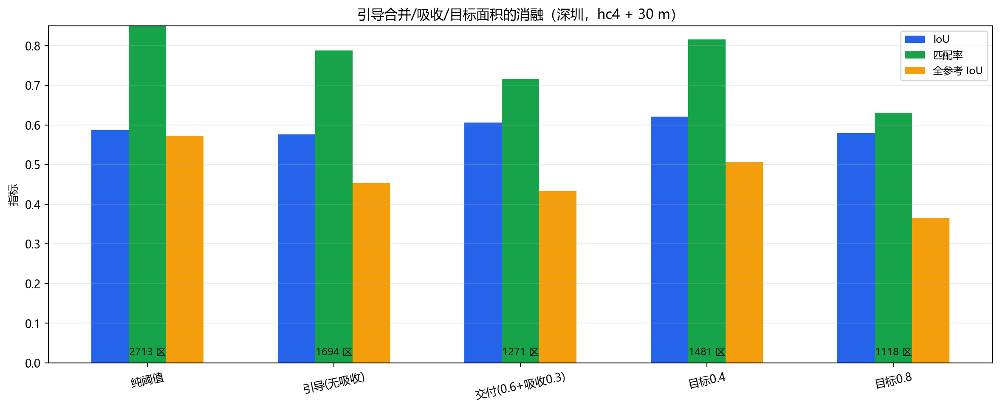

| 方案 | 区数 | IoU | 匹配率 | 全参考 IoU | 面积中位 | 说明 |
|---|---:|---:|---:|---:|---:|---|
| 纯阈值合并 | 2,713 | 0.5872 | 0.9760 | **0.5731** | 0.387 | 无引导/无吸收；区数远超参考，碎块多 |
| 只引导、不吸收 | 1,694 | 0.5758 | 0.7873 | 0.4533 | 0.763 | 区数接近参考，但 IoU 下降 |
| **交付（引导 + 吸收 0.3）** | **1,271** | **0.6057** | 0.7147 | 0.4329 | 0.991 | 碎块被吸收，IoU 最高 |

纯阈值合并的匹配率/全参考 IoU 看似很高，但代价是 2,713 个区、面积中位
只有 0.387 km²，大量碎块靠“多切”去碰参考；这不是合理的分区。引导合并
把区数拉回 1,694，但碎块仍在；0.3 km² 吸收把区数降到 1,271、面积中位
升到 0.991 km²，IoU 从 0.5758 提升到 0.6057。因此“先引导合并、再吸收
碎块”两步都需要，且吸收阈值 0.3 km² 是结构化与 IoU 的平衡点。

目标面积 0.4/0.8 km² 的补充消融：

| 引导目标 | 区数 | IoU | 匹配率 | 全参考 IoU | 边界 F1 | 面积中位 |
|---:|---:|---:|---:|---:|---:|---:|
| 0.4 km² | 1,481 | **0.6210** | **0.8155** | **0.5064** | **0.4866** | 0.82 km² |
| **0.6 km²（交付）** | **1,271** | 0.6057 | 0.7147 | 0.4329 | 0.4742 | 0.99 km² |
| 0.8 km² | 1,118 | 0.5795 | 0.6303 | 0.3653 | 0.4647 | 1.16 km² |

目标 0.4 km² 在“和参考方案对齐”上更高（区数 1,481、匹配率 0.8155），但
区更小更多，更接近标准微网格的尺寸分布；目标 0.8 km² 明显过度合并；
0.6 km² 牺牲了部分参考对齐度，换来更少、更大的稳定分区（面积中位
0.99 km²），并且是用户已验收图片的口径。如果唯一目标是刷新参考 IoU，
0.4 km² 更好；但交付选择 0.6 km²，优先保证城市级分区结构稳定、跨市一致，
而不是贴着参考格尺寸调参。这个取舍在参数消融图里可以直接看到。

---

## 8. 更多过程图

已有的逐阶段图：

- 深圳坪山：`figures/stages_pingshan.png` 与 `pingshan_01_raw ... 06_final`；
- 广州海珠：`figures/stages_haizhu.png` 与 `haizhu_01_raw ... 06_final`；
- 本次新增后处理对比：深圳福田/南山、佛山禅城/南海（见第 5 节）；
- 5 市全局/局部图：`figures/final_cities_hc4_r30/`；
- OSM 清洗前后线网图：见第 1 节。

这些图覆盖了“原始线网 → 清洗合并 → 原子面 → upper3 标签 → 面块对概率 →
草稿分区 → 后处理 → 30 m 收口”的完整链路。

---

## 9. 广东省外零样本示例

使用本交付文件夹内的上海、北京、福建 PBF，走与广东相同的 1.3.0 在线链
（prepare_lines → 辅助边 → select → clean → conflate → faces → pairs），
再套用 hc4 + 30 m 流程（模型只在广东训练，属于零样本）。省外没有移动标准
方案，因此只报告结构指标，不做 IoU 评估：

| 示例 | PBF | 范围 | 区数 | 面积 km² | 洞 | 多部件 | 耗时 |
|---|---|---|---:|---:|---:|---:|---:|
| 上海黄浦/静安 | shanghai-260903 | 121.44–121.50E, 31.21–31.25N | 30 | 25.4 | 0 | 0 | 45 s |
| 北京朝阳 | beijing-261114 | 116.42–116.48E, 39.89–39.93N | 21 | 22.8 | 0 | 0 | 48 s |
| 厦门思明 | fujian-261114 | 118.07–118.14E, 24.43–24.48N | 12 | 39.3 | 0 | 0 | 40 s |

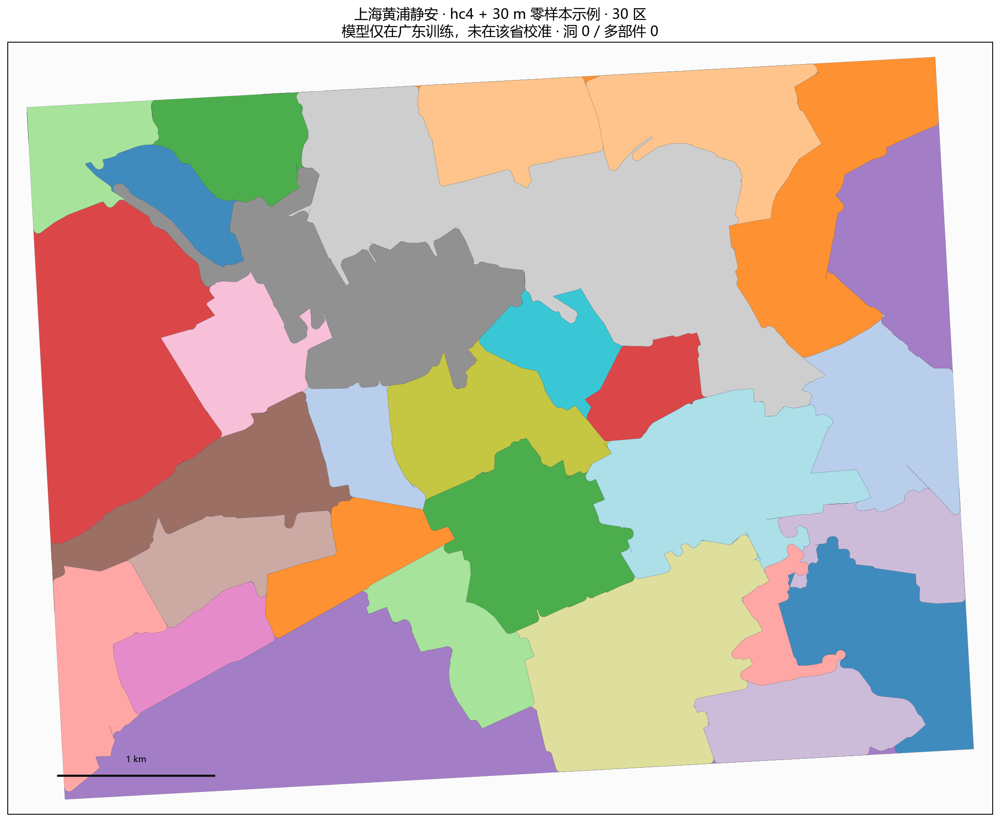

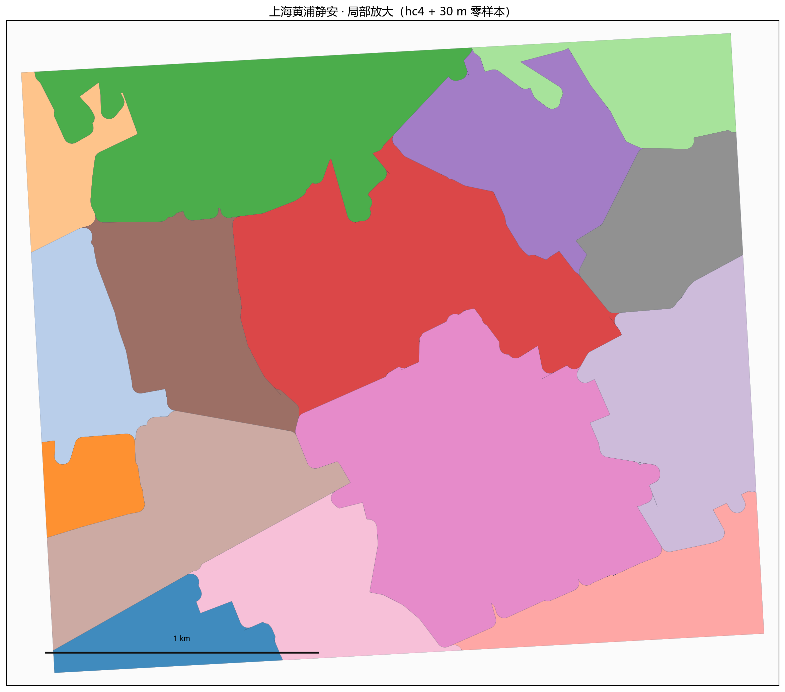

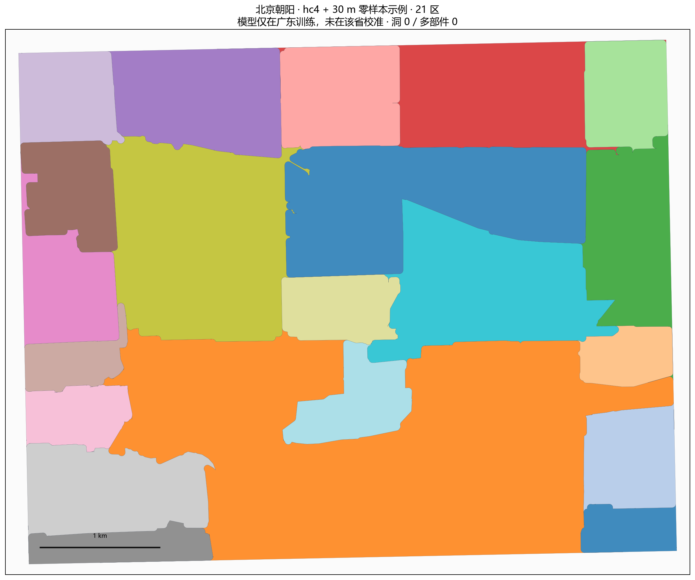

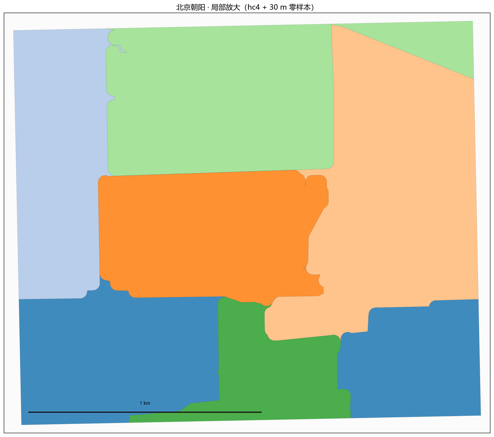

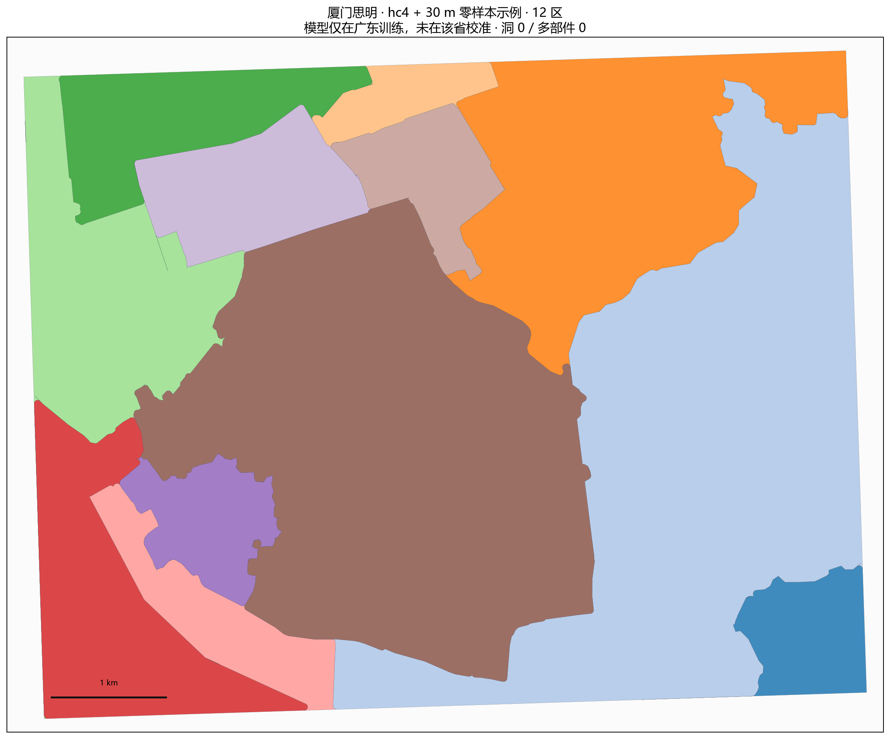

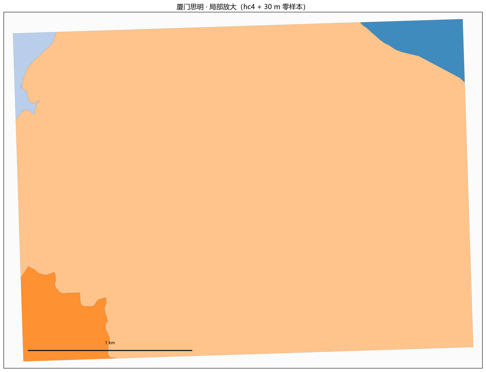

说明：

- 三个示例都是 0 洞/0 多部件，说明收口链路不依赖广东标准的参考格；
- 厦门 39.3 km² 只切出 12 区，明显比广东城区粗；这是零样本 + OSM 覆盖
  差异导致的，不应把省外示例当作已校准的生产效果；
- 要正式部署到外省，应按 README 放入目标省 PBF，重建 pairs 并训练/校准
  本地模型；当前交付只把省外作为“同一套算法可跑通”的演示。

这三个 PBF 已放在 `data/china/`，前端省目录会显示为可用；删除 PBF 后会
回到“目前无本地 OSM 数据，暂不支持”。

---

## 10. 在线与离线一致性：一次真实的踩坑

开发中发现：前端生成广州得到 1,594 区，离线评测图是 1,966 区；与参考的
贪心 IoU 只有 0.376，而离线是 0.564。模型、阈值、收口完全相同，问题只能
出在底图。

对比同一城市的线上/线下载体：

| 项 | 在线重建（修复前） | 训练/评测旧范式 |
|---|---:|---:|
| 线网条数 | 281,377 | 176,346 |
| 线网总长 | 137,198.5 km | 55,868.0 km |
| 原子面 | 36,205 | 41,455 |
| 面块对 | 70,443 | 84,246 |
| `a_area` 均值 | 0.953 | 0.717 |

线上直接用 `pipeline.lines/faces/pairs` 从 PBF 重建，语义合并和去重强度
与训练用的 1.3.0 `select → clean → conflate` 链不同；模型看到的面块对分布
发生偏移，于是把该合并的合并错、该保留的保留错。

修复分两层：

1. 广东城市生成直接复用
   `training/commercial_zoning/cache/province_1_5_0_legacy/<城市>/` 的训练
   同口径底图（`lines/upper3-faces/pairs_pbf`）和配套的
   `eval_frame.geojson` 评测外框，这是**预处理数据，不是最终分区结果**；
   这样前端与离线图不仅同底图、同模型，连后处理范围也一致；
2. 无缓存地区（县/区、bbox、省外、或广东底图缺失）由
   `pipeline/legacy_online.py` 在线执行**同一条**链：
   `prepare_lines → augment_province_aux → osm_base_select → osm_base_clean
   → base_conflate → build_faces_from_lines → build_province_face_pairs →
   augment_pairs_pbf`，参数与训练链一致，然后进入同一套 hc4/引导合并/
   后处理/30 m 收口。

广东城市逐区验证（珠海）：前端 455 区 vs 离线图 455 区，平均最佳 IoU
**1.0000**（最小 1.0000）；贪心 IoU 0.6276、匹配率 0.8513、全参考 0.5343、
边界 F1 0.4588，与离线结果完全相同。

广州（通过 `/zoning/jobs` 真实前端任务验证，耗时 1,266.8 s）：

- 前端 1,966 区，离线图 1,966 区；
- 逐区比较：平均最佳 IoU **1.0000**，最小 1.0000，**100%** 的区 IoU≥0.999；
- 线上贪心 IoU 0.5636、匹配率 0.8388、全参考 IoU 0.4728、边界 F1 0.3265；
  离线图分别为 0.5636 / 0.8388 / 0.4728 / 0.3266（0.0001 为多边形浮点/取整差）；
- 两者都是 0 洞/0 多部件。

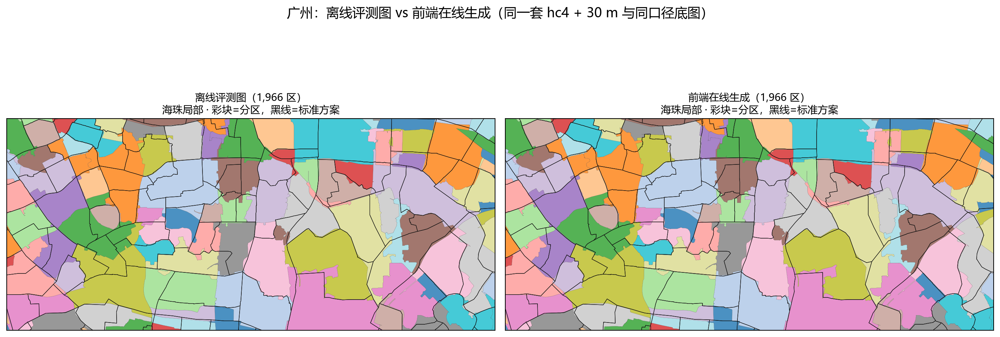

对于没有移动标准方案的省外区域，在线链用目标区域边界代替参考格外框；
流程、工具和参数不变，但不会读取参考 CSV（省外也没有参考），因此与广东
旧缓存不是逐字节相同，这是输入不同导致的，而不是又走了一套简化重建。

教训：模型精度不仅取决于模型，还取决于**服务端和训练端是否使用同一套
预处理**。这也是交付包必须包含 `training/` 底图与模型文件、不能只拷
`app/` 的原因。

---

## 11. 全流程步骤与参数：证据一览

| 步骤/参数 | 具体做法 | 证据 |
|---|---|---|
| 13 类候选线 | 道路 5 档 + 水系 4 类 + 铁路/行政/用地/自然/POI | 第 2 节：所有类别均有贡献；合并覆盖 76.7%（深圳，25 m） |
| 去重/语义合并 | 线段级去重、断点修复、10 m 语义合并 | 第 1 节：深圳线长 -76.0%，广州 -65.0%，局部视觉明显变干净 |
| 原子面 | 线网多边形化，过滤 <10,000 m² 碎面 | 第 4 节：深圳 25,169 个面、48,456 对面块对 |
| upper3 标签 | 最大重叠后做连续化 | 第 4 节：不连通标签 57.1% → 14.4%；最终 IoU 达标签上限 97% |
| 90 特征 XGB | 58 基础 + 32 上下文，12,000 树 depth 7 | 第 6 节：82/90 特征参与分裂；质心距离、共享边比例、道路等级/用地最重要 |
| 阈值 0.8 | 概率 ≥0.8 合并 | 第 7 节：0.70 过度合并（匹配率 0.638），0.85 略过分割；0.8 为统一平衡点 |
| 引导目标 0.6 km² | 小分区沿最强概率边合并 | 第 5 节：草稿 1,751 区 → 后处理 1,248 区；第 7 节：纯阈值 2,713 区、只引导 1,694 区、交付 1,271 区 |
| 碎块吸收 0.3 km² | 吸收 <0.3 km² 碎块 | 第 5 节：深圳吸收 504 个碎块，IoU +0.052 |
| 补缝/清洞/消重叠 | Voronoi 补缝、清洞、单部件 | 第 5 节：缝隙 110.9 → 0.001 km²，洞 13,864 → 0 |
| 30 m 收口 | `refine_best` 形态开闭 + 拓扑收尾 | 第 5 节半径对比；30 m 指标不降且视觉最平衡 |
| 省级聚合 | >25,000 km² 按市生成再聚合 | 广东约 17.9 万 km²，一次性装入内存不可行；按市逐个处理、可断点续跑 |
| 省外零样本 | 同一在线链 + hc4 直接推理 | 第 9 节：上海 30 区、北京 21 区、厦门 12 区，均 0 洞/0 多部件 |

---

## 复现命令

```bash
# 线网/候选边界评测与图
python docs/algorithm_guide/analysis_osm_boundaries.py --city 深圳
python docs/algorithm_guide/analysis_osm_boundaries.py --city 广州
python docs/algorithm_guide/analysis_uncovered.py

# upper3 标签连续性
python docs/algorithm_guide/analysis_labels.py

# 后处理各阶段
python training/tools/eval_stages.py --cities 深圳,佛山

# 阈值/参数消融（耗时较长）
python docs/algorithm_guide/analysis_ablations.py

# XGB 可解释性
python docs/algorithm_guide/analysis_xgb.py

# 省外零样本
python docs/algorithm_guide/analysis_outside.py
```
